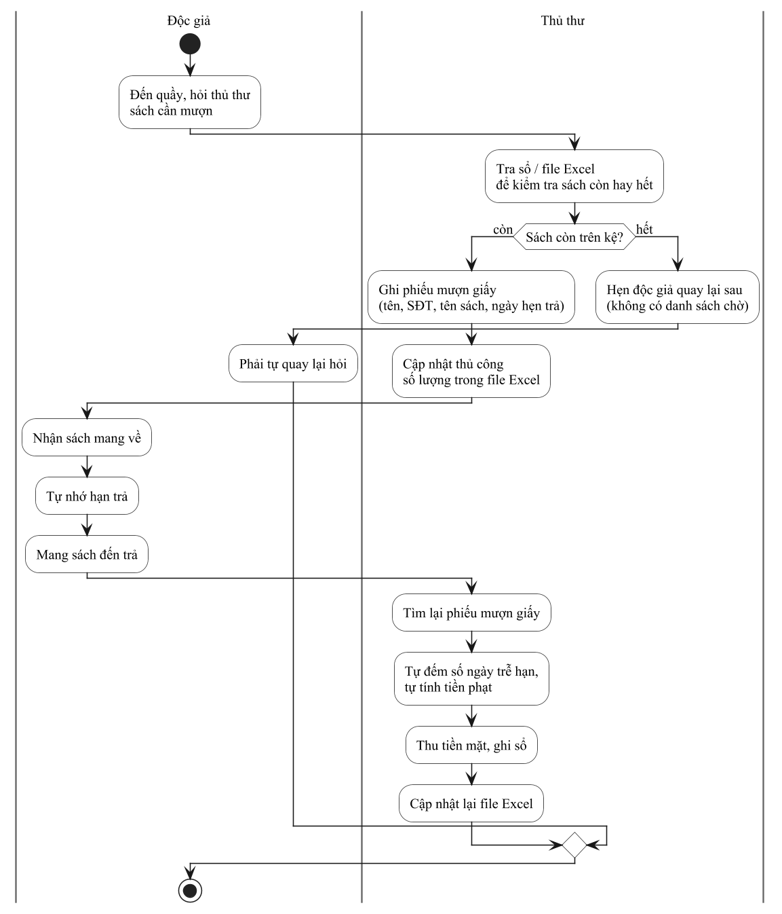
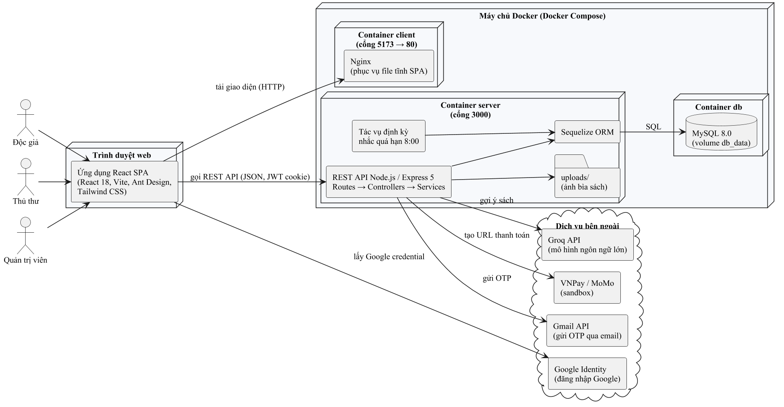

# 1. Giới thiệu

## 1.1 Đặt vấn đề

### 1.1.1 Bối cảnh

Bên cạnh hoạt động bán lẻ, nhiều nhà sách hiện nay mở rộng thêm không gian đọc và dịch vụ cho khách hàng mượn sách nhằm giữ chân khách hàng thân thiết, lan tỏa văn hóa đọc và tận dụng lượng sách trưng bày. Khi đó, nhà sách thực chất vận hành thêm một "thư viện thu nhỏ" với đầy đủ các nghiệp vụ của một thư viện: quản lý đầu sách và số bản, cấp tài khoản cho người đọc, cho mượn, nhận trả, gia hạn, xử lý trễ hạn, mất hoặc hư hỏng sách.

Đồ án này lấy Công ty Cổ phần Phát hành sách TP.HCM (FAHASA) làm hình mẫu tham chiếu cho bối cảnh bài toán. FAHASA là doanh nghiệp phát hành sách có mạng lưới kho hàng và nhà sách trên khắp cả nước, và chú trọng ứng dụng công nghệ vào vận hành như kho thông minh, nhà sách thông minh và tự thanh toán [1]. Sản phẩm của đồ án vì vậy mang tên demo **"Fahasa Digital"**.

Cần lưu ý rằng đây là đồ án học tập độc lập. Em không hợp tác và không được FAHASA đặt hàng. Em cũng không có thông tin về việc FAHASA có vận hành dịch vụ cho mượn sách hay không. Do đó, kịch bản nghiệp vụ trong báo cáo là **kịch bản giả định**: một nhà sách theo mô hình của FAHASA (sau đây gọi tắt là "nhà sách") mở thêm khu thư viện cho khách hàng thành viên mượn sách về nhà. Để thiết kế, em đặt ra các giả định về quy mô như sau. Đây là giả định thiết kế, không phải số liệu khảo sát:

- Kho sách cho mượn có quy mô từ vài trăm đến vài nghìn đầu sách, mỗi đầu sách có một hoặc nhiều bản.
- Số độc giả thành viên ở mức vài trăm đến vài nghìn người.
- Mỗi ca làm việc có từ một đến ba nhân viên kiêm nhiệm vai trò thủ thư.
- Nhà sách không có bộ phận công nghệ thông tin riêng và không có nhân sự được đào tạo chuyên sâu về nghiệp vụ thư viện.

### 1.1.2 Hiện trạng quy trình

Trong kịch bản giả định, hoạt động cho mượn sách của nhà sách đang được quản lý thủ công bằng sổ ghi chép và tệp Excel. Quy trình mượn – trả hiện tại được mô tả trong Hình 1.1.

Theo Hình 1.1, toàn bộ thông tin về sách, người mượn và tiền phạt nằm rải rác trong sổ giấy và tệp Excel do thủ thư tự cập nhật. Độc giả không có cách nào biết trước sách còn hay hết nếu không đến tận quầy, và cũng không nhận được nhắc nhở khi sắp đến hạn trả.

### 1.1.3 Định nghĩa vấn đề

Từ hiện trạng trên, em xác định sáu vấn đề cụ thể cần giải quyết. Các vấn đề được đánh mã VĐ-01 đến VĐ-06 để đối chiếu với giải pháp ở mục 1.3:

- **VĐ-01 – Thông tin kho sách không chính xác và không theo thời gian thực.** Số lượng sách còn, đang cho mượn, bị mất hoặc hỏng được cập nhật thủ công nên dễ sai lệch. Độc giả không thể tự tra cứu sách trước khi đến nhà sách.
- **VĐ-02 – Quy trình mượn, trả và gia hạn phụ thuộc hoàn toàn vào quầy.** Mọi thao tác đều phải gặp trực tiếp thủ thư. Phiếu mượn giấy dễ thất lạc và khó tra cứu lại lịch sử mượn của một độc giả.
- **VĐ-03 – Tính tiền phạt thủ công, thiếu minh bạch.** Thủ thư tự đếm số ngày trễ hạn và tự ước tính mức đền bù khi mất hoặc hỏng sách, nên dễ sai sót và dễ phát sinh tranh cãi. Việc thu phạt chỉ hỗ trợ tiền mặt.
- **VĐ-04 – Không có cơ chế nhắc hạn và hàng chờ.** Độc giả thường quên hạn trả. Khi một đầu sách đã hết, không có danh sách chờ nên người đến sau phải tự quay lại hỏi nhiều lần.
- **VĐ-05 – Thiếu số liệu phục vụ quản lý.** Chủ nhà sách không có số liệu tổng hợp về lượt mượn theo thời gian, sách được quan tâm, số sách quá hạn hay doanh thu tiền phạt để ra quyết định nhập thêm sách.
- **VĐ-06 – Khó tìm sách phù hợp.** Độc giả chỉ có thể hỏi thủ thư hoặc tự xem kệ. Nhà sách không có kênh tư vấn hay gợi ý sách dựa trên sở thích và lịch sử đọc của từng người.

### 1.1.4 Đối tượng bị ảnh hưởng

Các nhóm đối tượng chịu ảnh hưởng của những vấn đề trên được tổng hợp trong Bảng 1.1.

**Bảng 1.1: Các đối tượng bị ảnh hưởng và nhu cầu chính**

| Đối tượng | Vai trò trong bài toán | Vấn đề gặp phải | Nhu cầu chính |
|---|---|---|---|
| Độc giả (khách hàng thành viên) | Người tra cứu, mượn, trả và đánh giá sách | VĐ-01, VĐ-02, VĐ-04, VĐ-06 | Tra cứu trực tuyến, gửi yêu cầu mượn và gia hạn từ xa, được nhắc hạn, được gợi ý sách |
| Thủ thư (nhân viên nhà sách) | Người duyệt mượn, nhận trả, quản lý kho sách và độc giả | VĐ-01, VĐ-02, VĐ-03 | Công cụ quản lý tập trung, tự động tính phạt, in phiếu mượn, giảm thao tác ghi chép |
| Chủ nhà sách / quản trị viên | Người ra quyết định, quản lý tài khoản và cấu hình hệ thống | VĐ-03, VĐ-05 | Số liệu thống kê, báo cáo xuất được, kiểm soát phân quyền và thu phạt minh bạch |

### 1.1.5 Mục tiêu và phạm vi của đồ án

**Mục tiêu.** Em xây dựng một hệ thống web quản lý thư viện cho nhà sách, cho phép số hóa toàn bộ vòng đời mượn – trả sách. Hệ thống tự động hóa các nghiệp vụ dễ sai sót (cập nhật kho, tính phạt, nhắc hạn, quản lý hàng chờ) và cung cấp kênh tra cứu, gợi ý sách trực tuyến cho độc giả.

**Phạm vi thực hiện:**

- Ba vai trò người dùng: Độc giả, Thủ thư và Quản trị viên.
- Quản lý danh mục sách, gồm danh mục, thể loại, tác giả, nhà xuất bản, đầu sách và số lượng bản.
- Quy trình mượn, duyệt, trả, gia hạn và đặt trước sách; tính phạt tự động; thanh toán phạt trực tuyến ở môi trường thử nghiệm (sandbox).
- Đánh giá sách, thông báo trong hệ thống, trang tin tức và liên hệ.
- Trợ lý trò chuyện gợi ý sách dựa trên trí tuệ nhân tạo (AI), cụ thể là mô hình ngôn ngữ lớn.
- Bảng điều khiển thống kê và xuất báo cáo Excel/PDF.
- Đóng gói triển khai bằng Docker.

**Ngoài phạm vi:**

- Nghiệp vụ bán hàng của nhà sách (hóa đơn, nhập hàng, khuyến mãi).
- Biên mục theo chuẩn thư viện chuyên nghiệp (MARC 21, khung phân loại DDC).
- Tài liệu điện tử và đọc sách trực tuyến.
- Ứng dụng di động gốc (native).
- Triển khai trên máy chủ công khai (máy chủ riêng ảo – VPS, hoặc dịch vụ đám mây).

## 1.2 Các giải pháp đã có

Để xác định khoảng trống mà đồ án cần lấp, em khảo sát bốn nhóm giải pháp hiện có. Đó là hệ thống thư viện của Trường Đại học Phenikaa, phần mềm thư viện mã nguồn mở Koha khi nhà sách tự triển khai, phần mềm thư viện thương mại Libol, và phần mềm quản lý bán hàng nhà sách.

### 1.2.1 Hệ thống thư viện của Trường Đại học Phenikaa

Trung tâm Thông tin – Thư viện Đại học Phenikaa hiện ứng dụng phần mềm quản trị thư viện điện tử Koha, Thư viện số DRM và Cổng thông tin thư viện. Trung tâm áp dụng các chuẩn nghiệp vụ AACR2, Dublin Core và khung phân loại DDC, quản lý hơn 62.000 tài liệu in cùng nhiều tài liệu số, và có ứng dụng di động PU-LIC [2].

Theo hướng dẫn của Trung tâm, giao diện tra cứu trực tuyến (OPAC) trên nền Koha cho phép bạn đọc [3]:

- Tìm kiếm tài liệu và xem thông tin chi tiết, bao gồm trạng thái tài liệu.
- Quản lý tài khoản cá nhân.
- Đặt mượn tài liệu.
- Gửi đề xuất mua tài liệu.
- Bình luận, đánh giá tài liệu.
- Tạo giá sách ảo.

Quy trình mượn – trả được quy định chi tiết trong Nội quy Trung tâm. Thời hạn và số lượng mượn khác nhau theo đối tượng bạn đọc và loại tài liệu. Ví dụ, sinh viên được mượn tối đa 10 tài liệu mỗi lần; sách tham khảo được mượn 30 ngày và gia hạn một lần [4]. Mức phạt quá hạn là 2.000 đồng/ngày/tài liệu. Trường hợp mất hoặc hư hỏng không phục hồi được, bạn đọc phải đền sách hoặc đền tiền theo quy định kèm phí xử lý 50.000 đồng [5].

**Hạn chế khi áp dụng cho bài toán của nhà sách:**

- Hệ thống được thiết kế cho thư viện đại học quy mô lớn, gắn với tài khoản sinh viên và cán bộ của trường cùng các chuẩn biên mục chuyên nghiệp. Nhà sách không có cán bộ nghiệp vụ thư viện sẽ khó vận hành một hệ thống tương tự.
- Theo Nội quy, khi hết hạn mượn, bạn đọc phải mang tài liệu đến gia hạn trực tiếp, gửi email hoặc liên hệ qua hotline, fanpage [4]. Như vậy, gia hạn vẫn cần sự can thiệp thủ công của cán bộ thư viện.
- Em không tìm thấy thông tin công khai về việc thanh toán tiền phạt trực tuyến hoặc tính năng gợi ý sách cá nhân hóa trên các kênh của Trung tâm.

### 1.2.2 Phần mềm mã nguồn mở Koha (nhà sách tự triển khai)

Koha là gói phần mềm tự động hóa thư viện mã nguồn mở đầu tiên, phát hành theo giấy phép GNU GPL phiên bản 3 trở lên [6]. Koha hướng đến thư viện ở mọi quy mô, từ thư viện đơn lẻ đến liên hiệp thư viện. Phần mềm có đầy đủ các phân hệ bổ sung, lưu thông, biên mục, quản lý ấn phẩm định kỳ, báo cáo, in nhãn, gửi thông báo nhiều định dạng và lưu thông ngoại tuyến. Koha hỗ trợ các chuẩn MARC 21, UNIMARC, Z39.50 và SIP2 [6]. Đây cũng là nền tảng mà Thư viện Đại học Phenikaa đang sử dụng [2], [3]. Theo tài liệu hướng dẫn chính thức, phân hệ lưu thông của Koha hỗ trợ mượn, trả, gia hạn (kể cả cho phép bạn đọc tự gia hạn trên OPAC nếu thư viện cho phép), đặt giữ tài liệu, theo dõi quá hạn và quản lý tiền phạt [7]. Theo EIFL, phân hệ OPAC cung cấp giao diện để bạn đọc tìm kiếm, đặt giữ và đề xuất tài liệu mới [8].

**Hạn chế khi áp dụng cho bài toán của nhà sách:**

- Không mất phí bản quyền, nhưng việc cài đặt, cấu hình quy tắc lưu thông, biên mục theo MARC và bảo trì máy chủ đòi hỏi nhân sự có chuyên môn kỹ thuật và nghiệp vụ thư viện. Nhà sách nhỏ thường không có các nguồn lực này.
- Giao diện và quy trình bám sát nghiệp vụ thư viện truyền thống, quá phức tạp so với nhu cầu của một khu cho mượn sách trong nhà sách.
- Em không tìm thấy trong tài liệu chính thức của Koha tính năng tích hợp sẵn các cổng thanh toán phổ biến tại Việt Nam (VNPay, MoMo) hay trợ lý gợi ý sách bằng mô hình ngôn ngữ lớn. Nếu cần, nhà sách phải tự phát triển thêm.

### 1.2.3 Phần mềm thư viện thương mại Libol

Libol là giải pháp thư viện điện tử – thư viện số do Công ty Tinh Vân phát triển. Phiên bản Libol Bookworm đạt danh hiệu Sao Khuê năm 2018 và được Trung tâm Thông tin – Thư viện Đại học Quốc gia Hà Nội triển khai từ đầu năm 2018 [9]. Giải pháp này kết hợp hệ thống quản lý thư viện số Libol Digital với ứng dụng mượn – đọc sách điện tử Bookworm. Libol Bookworm cho phép theo dõi và báo cáo mượn – trả theo thời gian thực, đồng thời hỗ trợ mượn, đọc, trả, gia hạn và đặt trước tài liệu điện tử mọi lúc mọi nơi, kèm bảo vệ bản quyền số [9].

**Hạn chế khi áp dụng cho bài toán của nhà sách:**

- Là phần mềm thương mại hướng đến thư viện của các cơ quan và trường học, cần chi phí bản quyền và triển khai; mô hình này khó phù hợp với một khu cho mượn sách quy mô nhỏ.
- Các tính năng nổi bật (lưu thông tài liệu điện tử, bảo vệ bản quyền số) tập trung vào tài liệu số, trong khi bài toán của nhà sách chủ yếu là sách in.

### 1.2.4 Phần mềm quản lý bán hàng nhà sách và công cụ văn phòng

Nhiều nhà sách đang dùng phần mềm quản lý bán hàng, ví dụ KiotViet, để quản lý hàng hóa. Phần mềm này cho phép khai báo sách theo tên, tác giả, thể loại, nhà xuất bản, quản lý tồn kho, xây dựng chương trình khuyến mãi, và bán hàng trực tiếp lẫn trực tuyến [10]. Bên cạnh đó, các công cụ văn phòng như Excel thường được dùng để ghi chép thủ công như kịch bản hiện trạng ở mục 1.1.2.

**Hạn chế khi áp dụng cho bài toán của nhà sách:**

- Phần mềm bán hàng được thiết kế cho nghiệp vụ mua bán: hàng xuất kho là kết thúc giao dịch. Phần mềm không có khái niệm "phiếu mượn", "hạn trả", "gia hạn", "đặt trước" hay "tiền phạt quá hạn".
- Excel không có phân quyền, không có giao diện cho độc giả và không tự động nhắc hạn. Excel cũng dễ phát sinh sai lệch khi nhiều người cùng chỉnh sửa.

### 1.2.5 So sánh tổng hợp

Bảng 1.2 tổng hợp các giải pháp trên theo những tiêu chí gắn với các vấn đề VĐ-01 đến VĐ-06. Với các tiêu chí ghi "Không tìm thấy thông tin", em không tìm được tài liệu công khai xác nhận, chứ không khẳng định giải pháp đó không có tính năng.

**Bảng 1.2: So sánh các giải pháp đã có với giải pháp đề xuất**

| Tiêu chí | Thư viện ĐH Phenikaa (Koha) | Koha tự triển khai | Libol | Phần mềm bán hàng / Excel | Giải pháp đề xuất |
|---|---|---|---|---|---|
| Đối tượng chính | Thư viện đại học | Thư viện mọi quy mô | Thư viện cơ quan, trường học | Cửa hàng bán lẻ | Khu cho mượn sách của nhà sách |
| Tra cứu sách trực tuyến (VĐ-01) | Có [3] | Có [8] | Có [9] | Không (chỉ quản lý hàng hóa) [10] | Có |
| Đặt mượn trực tuyến (VĐ-02) | Có [3] | Có, đặt giữ [7], [8] | Có, với tài liệu điện tử [9] | Không | Có, thủ thư duyệt |
| Gia hạn trực tuyến (VĐ-02) | Trực tiếp, email hoặc hotline [4] | Có, nếu thư viện cho phép [7] | Có, với tài liệu điện tử [9] | Không | Có, tối đa 2 lần |
| Quản lý tiền phạt (VĐ-03) | Có quy định mức phạt [5] | Có [7] | Không tìm thấy thông tin | Không | Có, tự động tính |
| Thanh toán phạt trực tuyến (VĐ-03) | Không tìm thấy thông tin | Không tìm thấy thông tin | Không tìm thấy thông tin | Không | Có (VNPay, MoMo – sandbox) |
| Đặt trước, nhắc hạn (VĐ-04) | Không tìm thấy thông tin | Có đặt giữ, thông báo [6], [7] | Có đặt trước [9] | Không | Có, hàng chờ và nhắc tự động |
| Thống kê, báo cáo (VĐ-05) | Không tìm thấy thông tin | Có [6] | Có [9] | Có (doanh số bán hàng) | Có, xuất Excel/PDF |
| Gợi ý sách bằng AI (VĐ-06) | Không tìm thấy thông tin | Không có sẵn | Không tìm thấy thông tin | Không | Có |
| Yêu cầu chuyên môn để vận hành | Cao (cán bộ nghiệp vụ) | Cao (kỹ thuật và nghiệp vụ) | Trung bình – cao | Thấp | Thấp – trung bình |
| Chi phí phần mềm | Không áp dụng | Miễn phí bản quyền (GPL) [6] | Thương mại | Thuê bao / miễn phí | Mã nguồn tự phát triển |

**Nhận xét.** Các hệ thống thư viện chuyên nghiệp (Koha, Libol, Thư viện ĐH Phenikaa) giải quyết tốt nghiệp vụ lưu thông. Tuy nhiên, chúng được thiết kế cho thư viện có cán bộ chuyên môn và có ngưỡng vận hành cao. Ngược lại, phần mềm bán hàng và Excel thì dễ dùng nhưng không hỗ trợ nghiệp vụ cho mượn. Như vậy, vẫn còn khoảng trống cho một hệ thống gọn nhẹ, đủ các nghiệp vụ mượn – trả cốt lõi, dễ vận hành với nhân viên nhà sách, đồng thời có các tiện ích hiện đại như thanh toán phạt trực tuyến và gợi ý sách cá nhân hóa.

## 1.3 Giải pháp đề xuất

### 1.3.1 Tổng quan giải pháp

Em đề xuất xây dựng **Fahasa Digital**, một hệ thống web quản lý thư viện cho nhà sách. Hệ thống gồm hai phân hệ dùng chung một máy chủ cung cấp giao diện lập trình ứng dụng (API):

- **Phân hệ độc giả** (giao diện công khai), cho phép độc giả:
  - Tìm kiếm và lọc sách nâng cao, xem chi tiết sách và mã QR của sách.
  - Gửi yêu cầu mượn, gia hạn và đặt trước khi sách hết.
  - Theo dõi lịch sử mượn và tiền phạt, thanh toán phạt trực tuyến.
  - Đánh giá sách, nhận thông báo.
  - Trò chuyện với trợ lý AI để được gợi ý sách.
- **Phân hệ quản trị** dành cho Thủ thư và Quản trị viên, cho phép:
  - Quản lý danh mục, thể loại, tác giả, nhà xuất bản và đầu sách.
  - Duyệt yêu cầu mượn và gia hạn, xác nhận trả sách kèm tình trạng sách, in phiếu mượn.
  - Quản lý tiền phạt, đặt trước, độc giả, đánh giá, bài viết và liên hệ.
  - Xem bảng thống kê, xuất báo cáo và cấu hình hệ thống.

Hệ thống áp dụng các quy tắc nghiệp vụ thống nhất, được cài đặt trực tiếp trong mã nguồn:

- Phạt quá hạn 2.000 đồng/ngày, tối thiểu 5.000 đồng.
- Phạt hư hỏng bằng 30% giá sách; mất sách bồi thường 100% giá sách.
- Mỗi phiếu mượn được gia hạn tối đa hai lần.
- Sách đặt trước được giữ 48 giờ sau khi có sách.
- Hệ thống tự động nhắc độc giả về các phiếu sắp đến hạn hoặc quá hạn vào 8 giờ sáng mỗi ngày.

### 1.3.2 Kiến trúc tổng thể

Hệ thống theo kiến trúc khách – chủ ba tầng, được đóng gói thành ba container Docker và điều phối bằng Docker Compose (Hình 1.2):

- **Tầng giao diện:** ứng dụng trang đơn (SPA) viết bằng React, được biên dịch thành tệp tĩnh và phục vụ qua máy chủ web Nginx.
- **Tầng nghiệp vụ:** máy chủ REST API viết bằng Node.js và Express. Mã nguồn tổ chức theo các lớp Routes → Controllers → Services. Máy chủ xác thực bằng JSON Web Token (JWT) lưu trong cookie và phân quyền theo vai trò.
- **Tầng dữ liệu:** hệ quản trị cơ sở dữ liệu MySQL 8.0, truy cập qua thư viện ánh xạ đối tượng – quan hệ (ORM) Sequelize.

Ngoài ra, máy chủ API tích hợp các dịch vụ bên ngoài: Groq API cho trợ lý gợi ý sách, VNPay và MoMo (môi trường sandbox) cho thanh toán phạt, Google Identity cho đăng nhập bằng tài khoản Google, và Gmail API để gửi mã xác thực dùng một lần (OTP) khi người dùng quên mật khẩu.

<!-- landscape -->

<!-- portrait -->

### 1.3.3 Điểm khác biệt so với các giải pháp đã có

Bảng 1.3 đối chiếu từng vấn đề đã nêu ở mục 1.1.3 với cách giải pháp đề xuất xử lý, đồng thời chỉ ra điểm khác biệt so với các giải pháp ở mục 1.2.

**Bảng 1.3: Đối chiếu vấn đề với giải pháp đề xuất**

| Vấn đề | Cách giải pháp đề xuất xử lý | Khác biệt so với giải pháp đã có |
|---|---|---|
| VĐ-01 | Số lượng tổng, còn trong kho, đang mượn, đã mất và đã hỏng của từng đầu sách được cập nhật tự động khi duyệt mượn và khi trả sách. Độc giả tra cứu trực tuyến theo tên sách, ISBN, tác giả, thể loại, nhà xuất bản, năm xuất bản. | Tương đương Koha/Libol về tra cứu, nhưng không yêu cầu biên mục theo chuẩn MARC. |
| VĐ-02 | Độc giả gửi yêu cầu mượn và gia hạn trực tuyến; thủ thư duyệt hoặc từ chối trên một màn hình. Hệ thống tự sinh mã phiếu mượn và cho phép in phiếu. | Gia hạn được thực hiện hoàn toàn trên hệ thống, khác với quy trình gia hạn trực tiếp hoặc qua email của Thư viện ĐH Phenikaa [4]. |
| VĐ-03 | Khi trả sách, phiếu phạt được tự động sinh theo tình trạng (quá hạn, hư hỏng, mất). Độc giả có thể thanh toán trực tuyến qua VNPay hoặc MoMo, hoặc nộp tiền mặt để thủ thư xác nhận. Thủ thư có quyền miễn phạt. | Tích hợp sẵn cổng thanh toán phổ biến tại Việt Nam, điều mà Koha phải phát triển thêm. |
| VĐ-04 | Hàng chờ đặt trước có thứ tự. Khi sách được trả, độc giả đầu hàng chờ được thông báo và giữ chỗ 48 giờ. Hệ thống nhắc hạn tự động hằng ngày và hiển thị thông báo trong ứng dụng. | Thay thế hoàn toàn việc độc giả phải tự quay lại hỏi trong quy trình thủ công. |
| VĐ-05 | Bảng điều khiển thống kê tổng số sách, độc giả, lượt mượn, sách đang mượn, sách quá hạn, kèm biểu đồ lượt mượn theo tháng và sách theo thể loại. Hỗ trợ xuất báo cáo Excel/PDF. | Gọn nhẹ hơn phân hệ báo cáo của Koha/Libol nhưng đủ cho nhu cầu của chủ nhà sách. |
| VĐ-06 | Trợ lý trò chuyện dùng mô hình ngôn ngữ lớn qua Groq API, chỉ gợi ý sách có trong danh mục của thư viện. Khi độc giả đã đăng nhập, trợ lý tham khảo lịch sử mượn để cá nhân hóa gợi ý. | Em không tìm thấy tính năng tương tự trong các giải pháp được khảo sát. |

Tóm lại, điểm khác biệt chính của giải pháp đề xuất gồm ba điểm:

1. Hệ thống được thiết kế riêng cho quy mô và nhân sự của một nhà sách, nên dễ vận hành hơn các hệ thống thư viện chuyên nghiệp.
2. Toàn bộ vòng đời mượn – gia hạn – đặt trước – trả – phạt – thanh toán được số hóa và tự động hóa trên một nền tảng.
3. Hệ thống bổ sung trợ lý AI gợi ý sách dựa trên dữ liệu thực của thư viện.

Bù lại, giải pháp không nhằm thay thế các hệ thống thư viện chuyên nghiệp ở những nghiệp vụ như biên mục chuẩn MARC, liên thông Z39.50 hay quản lý tài liệu số.

### 1.3.4 Công nghệ sử dụng

Các công nghệ chính được em lựa chọn được tóm tắt trong Bảng 1.4.

**Bảng 1.4: Công nghệ sử dụng trong hệ thống**

| Thành phần | Công nghệ | Vai trò |
|---|---|---|
| Giao diện người dùng | React 18, Vite, React Router 7 | Xây dựng ứng dụng trang đơn, định tuyến phía máy khách |
| Thư viện giao diện | Ant Design 5, Tailwind CSS 4, Lucide | Thành phần giao diện, bố cục, biểu tượng |
| Biểu đồ, xuất tệp | Chart.js, Recharts, jsPDF, SheetJS (xlsx), qrcode.react | Biểu đồ thống kê, xuất PDF/Excel, sinh mã QR |
| Máy chủ ứng dụng | Node.js, Express 5 | Cung cấp REST API |
| Truy cập dữ liệu | Sequelize 6, mysql2 | Ánh xạ đối tượng – quan hệ, truy vấn MySQL |
| Cơ sở dữ liệu | MySQL 8.0 | Lưu trữ dữ liệu nghiệp vụ |
| Xác thực, bảo mật | jsonwebtoken (JWT), bcrypt, cookie-parser | Cấp và kiểm tra token, băm mật khẩu |
| Tải tệp | Multer | Tải ảnh bìa sách lên máy chủ |
| Tích hợp ngoài | groq-sdk, vnpay, Google Identity, Nodemailer + Gmail API | Trợ lý AI, thanh toán, đăng nhập Google, gửi email OTP |
| Triển khai | Docker, Docker Compose, Nginx | Đóng gói và chạy ba dịch vụ client, server, db |
