# 2. Thiết kế và triển khai

Chương này trình bày các yêu cầu chức năng, yêu cầu phi chức năng và các ràng buộc của hệ thống Fahasa Digital, sau đó mô tả thiết kế giải pháp thông qua các kịch bản sử dụng, biểu đồ UML và giao diện người dùng. Toàn bộ yêu cầu và thiết kế trong chương được em đối chiếu trực tiếp với mã nguồn của hệ thống (thư mục `server/src` và `client/src`), nhằm bảo đảm những gì được mô tả trùng khớp với sản phẩm thực tế.

## 2.1 Các yêu cầu chức năng

### 2.1.1 Các tác nhân của hệ thống

Hệ thống có năm tác nhân, được mô tả trong Bảng 2.1. Trong đó, ba tác nhân con người tương ứng với ba giá trị của thuộc tính `role` trong bảng `users` (`reader`, `librarian`, `admin`). Hai tác nhân còn lại là các hệ thống bên ngoài và tác vụ tự động.

**Bảng 2.1: Các tác nhân của hệ thống**

| Tác nhân | Mô tả | Quyền chính |
|---|---|---|
| Khách | Người truy cập chưa đăng nhập | Xem trang chủ, tìm kiếm và xem chi tiết sách, đọc tin tức, gửi liên hệ, trò chuyện với trợ lý AI, đăng ký, đăng nhập |
| Độc giả (`reader`) | Khách hàng thành viên đã có tài khoản; kế thừa mọi quyền của Khách | Mượn, gia hạn, đặt trước, đánh giá sách, thanh toán phạt, nhận thông báo, quản lý hồ sơ |
| Thủ thư (`librarian`) | Nhân viên nhà sách phụ trách khu thư viện | Quản lý sách và danh mục, duyệt mượn và gia hạn, nhận trả sách, quản lý phạt, độc giả, đánh giá, bài viết, liên hệ, xem thống kê và xuất báo cáo |
| Quản trị viên (`admin`) | Chủ nhà sách hoặc người quản trị hệ thống; kế thừa mọi quyền của Thủ thư | Quản lý tài khoản và phân quyền, xóa dữ liệu danh mục, cấu hình hệ thống |
| Hệ thống bên ngoài và tác vụ định kỳ | Cổng thanh toán VNPay/MoMo, dịch vụ AI Groq, Google Identity, Gmail; bộ hẹn giờ nhắc hạn lúc 8:00 hằng ngày | Xử lý thanh toán, sinh câu trả lời gợi ý, xác thực Google, gửi email, gửi thông báo nhắc hạn |

### 2.1.2 Danh sách yêu cầu chức năng

Các yêu cầu chức năng (FR – Functional Requirement) được đánh mã từ FR-01 đến FR-33 và chia thành năm nhóm (Bảng 2.2 đến Bảng 2.5). Mức ưu tiên được phân thành ba bậc: **Cao** (bắt buộc để vận hành nghiệp vụ mượn – trả), **Trung bình** (nâng cao trải nghiệm hoặc hiệu quả quản lý) và **Thấp** (tiện ích bổ sung).

**Bảng 2.2: Yêu cầu chức năng nhóm Tài khoản và Tra cứu**

| Mã | Tên yêu cầu | Tác nhân | Mô tả | Ưu tiên |
|---|---|---|---|---|
| FR-01 | Đăng ký tài khoản | Khách | Khách nhập họ tên, email, mật khẩu và các thông tin tùy chọn (mã thành viên, khoa/đơn vị, lớp, số điện thoại) để tạo tài khoản. Tài khoản tự đăng ký luôn có vai trò Độc giả. Email không được trùng. | Cao |
| FR-02 | Đăng nhập, đăng xuất bằng email | Khách, Độc giả, Thủ thư, Quản trị viên | Xác thực bằng email và mật khẩu, cấp access token (15 phút) và refresh token (7 ngày) lưu trong cookie. Tài khoản bị khóa không đăng nhập được. Đăng xuất thu hồi khóa ký token. | Cao |
| FR-03 | Đăng nhập bằng Google | Khách | Người dùng đăng nhập bằng tài khoản Google. Nếu email chưa tồn tại, hệ thống tự tạo tài khoản Độc giả. | Thấp |
| FR-04 | Khôi phục mật khẩu bằng OTP | Khách | Người dùng nhập email, nhận mã OTP 6 chữ số qua email, sau đó nhập OTP và mật khẩu mới để đặt lại mật khẩu. | Trung bình |
| FR-05 | Quản lý hồ sơ cá nhân | Độc giả | Xem và cập nhật thông tin cá nhân, đổi mật khẩu, tải ảnh đại diện, xem thẻ thư viện. | Trung bình |
| FR-06 | Tìm kiếm và lọc sách | Khách, Độc giả | Tìm theo từ khóa (tên sách, ISBN), lọc theo tác giả, thể loại, danh mục, nhà xuất bản, năm xuất bản, tình trạng còn sách; sắp xếp theo mới nhất, tên sách, năm xuất bản. | Cao |
| FR-07 | Xem chi tiết sách | Khách, Độc giả | Hiển thị ảnh bìa, thông tin sách, số bản còn trong kho, điểm đánh giá trung bình, phân bố số sao, danh sách nhận xét và mã QR của sách. | Cao |
| FR-08 | Xem tin tức, gửi liên hệ | Khách, Độc giả | Xem danh sách và nội dung bài viết đã xuất bản; gửi biểu mẫu liên hệ (họ tên, email, chủ đề, nội dung). | Thấp |

**Bảng 2.3: Yêu cầu chức năng nhóm Nghiệp vụ của độc giả**

| Mã | Tên yêu cầu | Tác nhân | Mô tả | Ưu tiên |
|---|---|---|---|---|
| FR-09 | Gửi yêu cầu mượn sách | Độc giả | Độc giả chọn ngày mượn và ngày trả rồi gửi yêu cầu. Hệ thống chỉ chấp nhận khi sách còn trong kho, ngày trả sau ngày mượn và độc giả chưa có phiếu đang xử lý cho cùng đầu sách. Phiếu được sinh mã dạng `BM-YYYYMMDD-XXXXX`. | Cao |
| FR-10 | Theo dõi lịch sử mượn | Độc giả | Xem danh sách phiếu mượn của mình theo trạng thái (chờ duyệt, đang mượn, đã trả, từ chối, quá hạn, mất sách), kèm hạn trả và số lần đã gia hạn. | Cao |
| FR-11 | Gửi yêu cầu gia hạn | Độc giả | Với phiếu đang mượn hoặc quá hạn, độc giả chọn ngày trả mới (phải sau hạn hiện tại) và gửi yêu cầu. Mỗi phiếu được gia hạn tối đa 2 lần, mỗi thời điểm chỉ có một yêu cầu chờ duyệt. | Cao |
| FR-12 | Đặt trước sách | Độc giả | Khi sách hết, độc giả đặt trước để vào hàng chờ. Hệ thống hiển thị vị trí trong hàng chờ và cho phép độc giả hủy đặt trước. | Trung bình |
| FR-13 | Xem và thanh toán tiền phạt | Độc giả | Xem các phiếu phạt (loại, số tiền, trạng thái) và thanh toán trực tuyến qua VNPay hoặc MoMo (môi trường sandbox). | Trung bình |
| FR-14 | Đánh giá sách | Độc giả | Chấm điểm từ 1 đến 5 sao và viết nhận xét. Mỗi độc giả có một đánh giá cho mỗi đầu sách và có thể sửa hoặc xóa đánh giá của mình. | Thấp |
| FR-15 | Nhận và quản lý thông báo | Độc giả, Thủ thư, Quản trị viên | Hiển thị biểu tượng chuông kèm số thông báo chưa đọc; cho phép xem, đánh dấu đã đọc từng thông báo hoặc tất cả, và xóa thông báo. | Trung bình |
| FR-16 | Trò chuyện với trợ lý AI gợi ý sách | Khách, Độc giả | Người dùng đặt câu hỏi bằng ngôn ngữ tự nhiên. Trợ lý chỉ gợi ý sách có trong danh mục của thư viện (tối đa 4 cuốn mỗi lần), ưu tiên sách còn trong kho, và cá nhân hóa theo lịch sử mượn nếu người dùng đã đăng nhập. Sách gợi ý được hiển thị thành thẻ có ảnh bìa, tác giả, giá và tình trạng. | Trung bình |

**Bảng 2.4: Yêu cầu chức năng nhóm Nghiệp vụ của thủ thư**

| Mã | Tên yêu cầu | Tác nhân | Mô tả | Ưu tiên |
|---|---|---|---|---|
| FR-17 | Quản lý danh mục, thể loại, tác giả, nhà xuất bản | Thủ thư | Thêm, sửa, ẩn/hiện, tìm kiếm danh mục, thể loại (có màu nhãn), tác giả (có bút danh), nhà xuất bản; hiển thị số sách thuộc mỗi mục. Thao tác xóa chỉ dành cho Quản trị viên. | Cao |
| FR-18 | Quản lý đầu sách | Thủ thư | Thêm, sửa, ẩn/hiện sách; nhập ISBN (không trùng), mô tả, năm xuất bản, ngôn ngữ, số trang, giá bìa, tổng số lượng; gán danh mục, nhà xuất bản, nhiều tác giả và thể loại; tải lên tối đa 10 ảnh bìa; xem và in mã QR. | Cao |
| FR-19 | Duyệt hoặc từ chối yêu cầu mượn | Thủ thư | Duyệt yêu cầu (trừ số lượng còn trong kho, giữ ngày độc giả đã chọn hoặc dùng hạn mặc định 14 ngày) hoặc từ chối kèm lý do; in phiếu mượn. | Cao |
| FR-20 | Xác nhận trả sách | Thủ thư | Ghi nhận ngày trả và tình trạng sách (bình thường, hư hỏng, mất); cộng lại số lượng trong kho trừ trường hợp mất sách. | Cao |
| FR-21 | Duyệt hoặc từ chối gia hạn | Thủ thư | Duyệt yêu cầu gia hạn (cập nhật hạn trả, tăng số lần gia hạn) hoặc từ chối kèm ghi chú. | Cao |
| FR-22 | Quản lý tiền phạt | Thủ thư | Xem danh sách và thống kê phiếu phạt, xác nhận đã thu tiền mặt, miễn phạt kèm lý do. | Cao |
| FR-23 | Quản lý đặt trước | Thủ thư | Xem hàng chờ đặt trước theo từng đầu sách và hủy đặt trước khi cần. | Thấp |
| FR-24 | Quản lý độc giả | Thủ thư | Thêm, sửa thông tin, khóa và mở khóa tài khoản độc giả; tìm kiếm theo họ tên, email, mã thành viên. Thủ thư không được sửa tài khoản Thủ thư hoặc Quản trị viên khác. | Cao |
| FR-25 | Kiểm duyệt đánh giá | Thủ thư | Xem toàn bộ đánh giá, ẩn hoặc hiện đánh giá vi phạm. | Thấp |
| FR-26 | Quản lý bài viết và liên hệ | Thủ thư | Soạn, sửa, xóa, chuyển trạng thái nháp/xuất bản bài viết; xem, cập nhật trạng thái và xóa tin nhắn liên hệ. | Thấp |
| FR-27 | Xem bảng thống kê | Thủ thư | Hiển thị tổng số bản sách, số đầu sách, số độc giả, tổng lượt mượn, số sách đang mượn, số phiếu quá hạn, tổng tiền phạt đã thu; biểu đồ lượt mượn 6 tháng gần nhất, cơ cấu sách theo danh mục; top sách được mượn nhiều và top độc giả tích cực. | Trung bình |
| FR-28 | Xuất báo cáo | Thủ thư | Xuất ra Excel hoặc PDF các báo cáo: danh sách đầu sách, danh sách độc giả, danh sách mượn trả, sách quá hạn, doanh thu tiền phạt. | Trung bình |

**Bảng 2.5: Yêu cầu chức năng nhóm Quản trị và Tác vụ tự động**

| Mã | Tên yêu cầu | Tác nhân | Mô tả | Ưu tiên |
|---|---|---|---|---|
| FR-29 | Quản lý tài khoản và phân quyền | Quản trị viên | Tạo tài khoản với vai trò bất kỳ (Quản trị viên, Thủ thư, Độc giả), đổi vai trò, xóa tài khoản. | Cao |
| FR-30 | Cấu hình hệ thống | Quản trị viên | Cập nhật các tham số dịch vụ ngoài lưu trong bảng `system_configs`: email gửi OTP, thông tin OAuth2 của Gmail, khóa API của dịch vụ AI. | Trung bình |
| FR-31 | Tự động tính tiền phạt | Hệ thống | Khi xác nhận trả sách, hệ thống tự tạo phiếu phạt theo quy tắc BR-01 đến BR-03 (Bảng 2.6). | Cao |
| FR-32 | Tự động thông báo hàng chờ | Hệ thống | Khi một bản sách được trả (không mất), người đứng đầu hàng chờ đặt trước được chuyển sang trạng thái `notified` (đã thông báo), được giữ chỗ 48 giờ và nhận thông báo. | Trung bình |
| FR-33 | Nhắc hạn trả tự động | Hệ thống | Lúc 8:00 hằng ngày, hệ thống gửi thông báo cho độc giả có sách đến hạn sau 1 ngày và sau 3 ngày, và thông báo cho độc giả có phiếu quá hạn. Mỗi loại thông báo không gửi lặp quá một lần mỗi ngày. Thủ thư có thể kích hoạt thủ công. | Trung bình |

### 2.1.3 Quy tắc nghiệp vụ

Các yêu cầu chức năng trên vận hành theo những quy tắc nghiệp vụ được cài đặt trực tiếp trong tầng Service của máy chủ. Bảng 2.6 liệt kê các quy tắc này (đánh mã BR-01 đến BR-10, BR – Business Rule) cùng vị trí cài đặt, để thuận tiện cho việc kiểm thử ở Chương 4.

**Bảng 2.6: Các quy tắc nghiệp vụ**

| Mã | Quy tắc | Vị trí cài đặt |
|---|---|---|
| BR-01 | Phạt quá hạn = số ngày trễ × 2.000 đồng, tối thiểu 5.000 đồng | `fine.service.js` (`FINE_CONFIG`) |
| BR-02 | Phạt hư hỏng = 30% giá bìa; nếu sách không có giá thì phạt 50.000 đồng. Nếu trả hỏng và trễ hạn thì tạo thêm phiếu phạt quá hạn | `fine.service.js`, `borrow.service.js` |
| BR-03 | Phạt mất sách = 100% giá bìa; nếu sách không có giá thì phạt 100.000 đồng. Sách mất không được cộng lại vào kho | `fine.service.js`, `borrow.service.js` |
| BR-04 | Mỗi phiếu được gia hạn tối đa 2 lần (`renewLimit`); ngày trả mới phải sau hạn hiện tại | `borrow.service.js` |
| BR-05 | Hạn trả mặc định là 14 ngày kể từ ngày duyệt nếu phiếu chưa có hạn trả | `borrow.service.js` |
| BR-06 | Mỗi độc giả chỉ có một phiếu ở trạng thái chờ duyệt hoặc đang mượn cho cùng một đầu sách | `borrow.service.js` |
| BR-07 | Chỉ được đặt trước khi sách đã hết; mỗi độc giả chỉ đặt trước một lần cho mỗi đầu sách; giữ chỗ 48 giờ sau khi được thông báo | `reservation.service.js` |
| BR-08 | Nhắc hạn lúc 8:00 hằng ngày cho phiếu đến hạn sau 1 và 3 ngày | `server.js`, `notification.service.js` |
| BR-09 | Điểm đánh giá là số nguyên từ 1 đến 5; trang chủ chỉ hiển thị đánh giá từ 4 sao trở lên và không bị ẩn | `review.service.js` |
| BR-10 | Tài khoản tự đăng ký luôn có vai trò Độc giả; chỉ Quản trị viên được xóa tài khoản và dữ liệu danh mục | `users.service.js`, các tệp `*.routes.js` |

## 2.2 Các yêu cầu phi chức năng

Các yêu cầu phi chức năng (NFR – Non-functional Requirement) được đánh mã từ NFR-01 đến NFR-13 (Bảng 2.7). Mỗi yêu cầu đi kèm một tiêu chí đo được hoặc một cách kiểm chứng cụ thể, và sẽ được đánh giá lại ở Chương 4.

**Bảng 2.7: Các yêu cầu phi chức năng**

| Mã | Nhóm | Yêu cầu | Tiêu chí đo / cách kiểm chứng |
|---|---|---|---|
| NFR-01 | Hiệu năng | API tra cứu sách phản hồi nhanh khi có nhiều người dùng đồng thời | Với 20 kết nối đồng thời gọi `GET /api/books` trên môi trường Docker cục bộ: thời gian phản hồi trung vị ≤ 300 ms, phân vị 95 ≤ 1.000 ms, tỷ lệ lỗi 0% |
| NFR-02 | Hiệu năng | Trang giao diện tải nhanh | Trang chủ tải xong (sự kiện load) ≤ 3 giây trên máy phát triển; tài nguyên tĩnh được nén gzip và lưu đệm 1 năm qua Nginx |
| NFR-03 | Hiệu năng | Trợ lý AI phản hồi trong thời gian chấp nhận được | Thời gian phản hồi của `POST /api/ai/chat` ≤ 10 giây cho một câu hỏi |
| NFR-04 | Bảo mật | Mật khẩu và mã OTP không lưu ở dạng rõ | Băm bằng bcrypt (cost 10); không API nào trả về trường `password` |
| NFR-05 | Bảo mật | Xác thực bằng token an toàn | JWT ký RS256 bằng cặp khóa riêng của từng người dùng; access token hết hạn sau 15 phút, refresh token sau 7 ngày; cookie đặt `HttpOnly`, `SameSite=Strict`, `Secure` khi chạy production |
| NFR-06 | Bảo mật | Phân quyền và toàn vẹn dữ liệu | 100% API quản trị từ chối người dùng không đủ quyền; kết quả thanh toán và đăng nhập Google chỉ được chấp nhận khi đã xác thực chữ ký của bên thứ ba; mã OTP chỉ được gửi qua email |
| NFR-07 | Bảo mật | Không lộ thông tin bí mật trong mã nguồn | Khóa API, mật khẩu cơ sở dữ liệu, khóa bí mật cổng thanh toán được nạp từ biến môi trường hoặc bảng cấu hình, không ghi cứng trong mã nguồn |
| NFR-08 | Tin cậy | Dịch vụ tự phục hồi, dữ liệu bền vững | Container tự khởi động lại khi lỗi (`restart: unless-stopped`); máy chủ chỉ khởi động khi cơ sở dữ liệu đã sẵn sàng (healthcheck); dữ liệu MySQL lưu trong volume `db_data`, ảnh tải lên lưu trong volume `uploads_data`, nên không mất khi tạo lại container |
| NFR-09 | Khả dụng | Dễ sử dụng với người dùng phổ thông | Giao diện hoàn toàn bằng tiếng Việt; từ trang chi tiết sách, độc giả gửi được yêu cầu mượn trong không quá 3 thao tác; thông báo lỗi rõ ràng bằng tiếng Việt |
| NFR-10 | Tương thích | Chạy trên các trình duyệt phổ biến | Hoạt động trên phiên bản mới của Chrome, Edge, Firefox; bố cục co giãn từ màn hình 375 px đến 1920 px |
| NFR-11 | Triển khai | Triển khai bằng một lệnh | Toàn bộ hệ thống khởi chạy bằng `docker compose up -d`; máy chủ không cần cài sẵn Node.js hay MySQL |
| NFR-12 | Bảo trì | Mã nguồn dễ mở rộng | Máy chủ tách lớp Routes → Controllers → Services → Models; mã định dạng thống nhất bằng Prettier; lỗi nghiệp vụ trả về dạng JSON thống nhất `{success, message}` |
| NFR-13 | Quyền riêng tư | Hạn chế dữ liệu cá nhân gửi ra bên ngoài | Yêu cầu gửi tới dịch vụ AI chỉ chứa danh mục sách và tên, thể loại các sách độc giả đã mượn; không chứa họ tên, email, số điện thoại của độc giả |

## 2.3 Các ràng buộc

Ngoài các yêu cầu, hệ thống còn chịu những ràng buộc về môi trường triển khai, chi phí và đạo đức. Những ràng buộc này giới hạn các lựa chọn thiết kế của em.

### 2.3.1 Các ràng buộc về triển khai

Hệ thống hiện được triển khai trên máy tính cá nhân của em bằng Docker Desktop và **chưa được triển khai lên máy chủ riêng ảo (VPS)**. Cấu hình triển khai được định nghĩa trong tệp `docker-compose.yml` và tóm tắt trong Bảng 2.8.

**Bảng 2.8: Cấu hình triển khai bằng Docker Compose**

| Dịch vụ | Image / cách build | Cổng | Ghi chú |
|---|---|---|---|
| `db` | `mysql:8.0` | 3306 (chỉ trong mạng nội bộ Docker) | Healthcheck bằng `mysqladmin ping` mỗi 10 giây; dữ liệu lưu ở volume `db_data` |
| `server` | Build từ `server/Dockerfile` trên nền `node:20-alpine` | 3000 | Script `wait-for-db.sh` chờ MySQL sẵn sàng, tạo tài khoản quản trị mặc định rồi khởi động API; ảnh tải lên lưu ở volume `uploads_data` |
| `client` | Build nhiều giai đoạn: `node:20-alpine` biên dịch React, `nginx:alpine` phục vụ tệp tĩnh | 5173 → 80 | Nginx chuyển mọi đường dẫn về `index.html` (SPA), nén gzip, lưu đệm tài nguyên 1 năm |

Các ràng buộc triển khai cụ thể gồm:

- **Môi trường chạy:** máy cần cài Docker (Docker Desktop trên Windows/macOS hoặc Docker Engine trên Linux). Tại thời điểm em chụp Docker Desktop khi hệ thống đang chạy không tải, ba container sử dụng khoảng 577 MB bộ nhớ và dưới 1% CPU trên máy 8 nhân, 7,44 GB RAM cấp cho Docker. Đây là số liệu quan sát một lần, không phải kết quả đo tải.
- **Kết nối Internet:** các chức năng trợ lý AI (Groq API), thanh toán (VNPay, MoMo), đăng nhập Google và gửi OTP qua Gmail đều phụ thuộc dịch vụ bên ngoài. Khi mất kết nối, các nghiệp vụ mượn – trả cốt lõi vẫn hoạt động.
- **Cổng thanh toán chỉ ở môi trường thử nghiệm:** hệ thống dùng tài khoản sandbox của VNPay và MoMo. Kết quả thanh toán MoMo theo cơ chế IPN (máy chủ MoMo gọi về máy chủ của em) không hoạt động khi chạy trên `localhost`, nên hệ thống xử lý bổ sung ở bước chuyển hướng trình duyệt (`momoReturn`). Muốn nhận thanh toán thật, nhà sách phải ký hợp đồng với cổng thanh toán và triển khai máy chủ có tên miền công khai với HTTPS.
- **Cấu hình theo môi trường:** địa chỉ giao diện được phép gọi API (CORS) lấy từ biến `URL_CLIENT`; cờ `Secure` của cookie chỉ bật khi `NODE_ENV=production`. Do đó, khi đưa lên Internet bắt buộc phải dùng HTTPS và đặt `NODE_ENV=production`.
- **Lưu trữ tệp:** ảnh bìa sách và ảnh đại diện được lưu trong thư mục `server/uploads` của container server. Thư mục này được gắn volume `uploads_data`, nên ảnh không mất khi build lại image hay tạo lại container; chỉ mất khi chủ động xóa volume (ví dụ `docker compose down -v`). Khi triển khai thật, volume này cần được sao lưu định kỳ cùng với volume cơ sở dữ liệu.
- **Múi giờ:** container chạy theo giờ UTC. Mã phiếu mượn và tác vụ nhắc hạn lúc 8:00 tính theo giờ của container, nên khi triển khai cần đặt múi giờ `Asia/Ho_Chi_Minh` (UTC+7).

### 2.3.2 Các ràng buộc kinh tế

Đồ án được thực hiện trong điều kiện không có kinh phí. Vì vậy, em ưu tiên các công nghệ mã nguồn mở và dịch vụ có gói miễn phí. Bảng 2.9 tổng hợp các khoản chi phí trong giai đoạn phát triển và khi đưa vào vận hành thật.

**Bảng 2.9: Chi phí trong giai đoạn phát triển và khi vận hành thật**

| Hạng mục | Giai đoạn phát triển (đồ án) | Khi vận hành thật tại nhà sách |
|---|---|---|
| Thư viện và khung phần mềm (React, Express, Sequelize, Ant Design, Tailwind CSS, Nginx, MySQL Community) | Miễn phí (giấy phép mã nguồn mở) | Miễn phí |
| Docker | Docker Desktop miễn phí cho cá nhân, giáo dục và doanh nghiệp nhỏ dưới 250 nhân viên **và** dưới 10 triệu USD doanh thu/năm [11] | Doanh nghiệp vượt ngưỡng trên phải mua gói trả phí nếu dùng Docker Desktop; có thể dùng Docker Engine trên máy chủ Linux, vốn không thuộc điều khoản này [11] |
| Dịch vụ AI (Groq API, mô hình `openai/gpt-oss-120b`) | Gói miễn phí giới hạn 30 yêu cầu/phút, 1.000 yêu cầu/ngày, 8.000 token/phút, 200.000 token/ngày [12] | Theo lượng token sử dụng; chưa ước tính trong phạm vi đồ án |
| Cổng thanh toán VNPay, MoMo | Môi trường sandbox miễn phí | Phí giao dịch theo hợp đồng với cổng thanh toán; chưa ước tính trong phạm vi đồ án |
| Máy chủ (VPS), tên miền, chứng chỉ HTTPS | Không phát sinh (chạy cục bộ) | Phát sinh chi phí thuê máy chủ, tên miền và chứng chỉ HTTPS; chưa ước tính trong phạm vi đồ án |
| Nhân lực | Công sức của người thực hiện đồ án, không tính thành chi phí | Chi phí bảo trì, vận hành |

Trong giai đoạn đồ án, hệ thống chỉ được build và chạy trên máy cá nhân; các khóa API (Groq, Google, VNPay, MoMo) đều thuộc gói miễn phí hoặc tài khoản thử nghiệm, nên không phát sinh chi phí. Chi phí khi vận hành thật chưa được ước tính chi tiết và cần khảo sát báo giá khi triển khai.

Em đã đo trực tiếp một yêu cầu gợi ý sách trên hệ thống với danh mục 28 đầu sách. Yêu cầu này tiêu thụ 1.682 token (1.146 token đầu vào và 536 token đầu ra), thời gian xử lý phía Groq khoảng 1,2 giây. Với hạn mức 200.000 token/ngày của gói miễn phí, hệ thống phục vụ được khoảng 118 lượt hỏi mỗi ngày. Khi danh mục tăng lên mức tối đa 80 đầu sách được đưa vào ngữ cảnh, số token đầu vào sẽ tăng và số lượt hỏi mỗi ngày sẽ giảm tương ứng. Đây là ràng buộc cần cân nhắc khi lựa chọn gói dịch vụ.

### 2.3.3 Các ràng buộc về đạo đức

Hệ thống thu thập và xử lý dữ liệu cá nhân của độc giả, gồm họ tên, email, số điện thoại, địa chỉ, ngày sinh, mã thành viên, lịch sử mượn và tiền phạt. Do đó, việc thiết kế và vận hành hệ thống chịu các ràng buộc sau:

- **Tuân thủ pháp luật về dữ liệu cá nhân.** Luật Bảo vệ dữ liệu cá nhân số 91/2025/QH15 được Quốc hội thông qua ngày 26/6/2025 và có hiệu lực từ ngày 01/01/2026 [13]. Luật quy định các quyền của chủ thể dữ liệu như quyền được biết, quyền đồng ý, quyền truy cập, quyền chỉnh sửa và quyền yêu cầu xóa dữ liệu [13]. Hệ thống cần thông báo rõ mục đích thu thập dữ liệu khi đăng ký, chỉ thu thập dữ liệu cần thiết, và cho phép độc giả xem, sửa thông tin của mình (đã có ở FR-05).
- **Dữ liệu gửi cho dịch vụ AI.** Lịch sử mượn của độc giả được dùng để cá nhân hóa gợi ý. Theo NFR-13, hệ thống chỉ gửi tên và thể loại sách, không gửi thông tin định danh. Giao diện trợ lý cũng hiển thị lưu ý rằng AI có thể đưa ra thông tin chưa chính xác.
- **Minh bạch và công bằng trong xử lý phạt.** Mức phạt được tính tự động theo cùng một công thức cho mọi độc giả (BR-01 đến BR-03), thay vì phụ thuộc vào cách tính của từng thủ thư. Nhà sách cần công bố công khai các mức phạt này. Quyền miễn phạt của thủ thư phải đi kèm lý do và được lưu lại.
- **Trung thực trong thông tin hiển thị.** Mọi số liệu hiển thị cho người dùng phải phản ánh dữ liệu thật, lấy từ cơ sở dữ liệu thay vì gán cứng trong mã nguồn. Hiện trạng chưa đạt của ràng buộc này được trình bày ở mục 3.3.
- **Bản quyền nội dung.** Ảnh bìa và mô tả sách thường thuộc bản quyền của nhà xuất bản. Trong đồ án, ảnh bìa dùng để minh họa là ảnh do em tự tạo bằng chương trình. Khi vận hành thật, nhà sách cần sử dụng ảnh và mô tả được phép từ nhà xuất bản hoặc nhà phân phối.

## 2.4 Mô hình hệ thống / Thiết kế giải pháp

Như đã trình bày ở mục 1.3.2 (Hình 1.2), hệ thống gồm ba tầng: ứng dụng React chạy trên trình duyệt, máy chủ REST API Node.js/Express và cơ sở dữ liệu MySQL. Máy chủ API được tổ chức thành bốn lớp:

- **Routes:** khai báo đường dẫn và gắn middleware phân quyền `authUser`, `authAdmin`, `authAdminOrLibrarian`.
- **Controllers:** đọc tham số yêu cầu và trả kết quả theo định dạng thống nhất.
- **Services:** chứa toàn bộ quy tắc nghiệp vụ.
- **Models:** ánh xạ bảng dữ liệu bằng Sequelize.

Bảng 2.10 tóm tắt các nhóm API chính mà giao diện sử dụng.

**Bảng 2.10: Các nhóm API REST của hệ thống**

| Tiền tố | Chức năng chính | Quyền truy cập |
|---|---|---|
| `/api/users` | Đăng ký, đăng nhập (email, Google), làm mới token, quên/đặt lại mật khẩu, hồ sơ cá nhân; quản lý người dùng | Công khai; người dùng đã đăng nhập; Thủ thư/Quản trị viên (xóa: chỉ Quản trị viên) |
| `/api/books`, `/api/categories`, `/api/genres`, `/api/authors`, `/api/publishers` | Tra cứu (công khai) và thêm, sửa, ẩn/hiện (Thủ thư); xóa (Quản trị viên) | Công khai / Thủ thư / Quản trị viên |
| `/api/upload` | Tải lên, xóa ảnh (Multer) | Thủ thư |
| `/api/borrows` | Gửi yêu cầu mượn, lịch sử của tôi, gia hạn; duyệt, từ chối, trả sách, duyệt gia hạn, thống kê | Độc giả / Thủ thư |
| `/api/fines` | Phạt của tôi, tạo liên kết thanh toán, nhận kết quả VNPay/MoMo; danh sách, thu tiền, miễn phạt | Độc giả / Thủ thư / Công khai (đường dẫn trả về từ cổng thanh toán) |
| `/api/reservations` | Đặt trước, hủy, xem hàng chờ; quản lý đặt trước | Độc giả / Thủ thư |
| `/api/reviews` | Xem đánh giá; viết, sửa, xóa đánh giá của tôi; ẩn đánh giá | Công khai / Độc giả / Thủ thư |
| `/api/notifications` | Thông báo của tôi, đánh dấu đã đọc, xóa; kích hoạt nhắc hạn thủ công | Người dùng đã đăng nhập / Thủ thư |
| `/api/ai` | Trò chuyện với trợ lý gợi ý sách | Công khai (cá nhân hóa nếu đã đăng nhập) |
| `/api/dashboard`, `/api/system-configs` | Số liệu thống kê; đọc và cập nhật cấu hình | Thủ thư / Quản trị viên |
| `/api/articles`, `/api/contacts` | Tin tức, liên hệ | Công khai / Thủ thư |

### 2.4.1 Các kịch bản của hệ thống (Use-cases)

Từ các yêu cầu chức năng ở mục 2.1, em xác định 19 ca sử dụng (use-case, đánh mã UC-01 đến UC-19). Bảng 2.11 là bảng tổng hợp: với mỗi ca sử dụng, bảng cho biết tác nhân chính, các yêu cầu chức năng được hiện thực, bảng đặc tả chi tiết và kết quả kiểm thử ở Chương 4. Các biểu đồ use-case ở mục 2.4.2 (Hình 2.1 đến Hình 2.4) thể hiện trực quan cùng 19 ca sử dụng này.

**Bảng 2.11: Danh sách ca sử dụng**

| Mã | Tên ca sử dụng | Tác nhân chính | FR liên quan | Bảng đặc tả | Kiểm thử |
|---|---|---|---|---|---|
| UC-01 | Đăng ký tài khoản | Khách | FR-01 | 2.12 | Đạt 3/3 |
| UC-02 | Đăng nhập / đăng xuất | Khách, mọi người dùng | FR-02, FR-03 | 2.13 | Đạt 6/6; đã sửa SEC-01 |
| UC-03 | Khôi phục mật khẩu | Khách | FR-04 | 2.14 | Đã sửa SEC-02 |
| UC-04 | Tìm kiếm, xem chi tiết sách | Khách, Độc giả | FR-06, FR-07 | 2.15 | Đạt 1/1 |
| UC-05 | Gửi yêu cầu mượn sách | Độc giả | FR-09, FR-10 | 2.16 | Đạt 3/4 |
| UC-06 | Duyệt yêu cầu mượn | Thủ thư | FR-19, FR-15 | 2.17 | Đạt 5/5 |
| UC-07 | Xác nhận trả sách | Thủ thư | FR-20, FR-31, FR-32 | 2.18 | Đạt 7/8 |
| UC-08 | Gia hạn sách | Độc giả, Thủ thư | FR-11, FR-21 | 2.19 | Đạt 4/4 |
| UC-09 | Đặt trước sách | Độc giả | FR-12, FR-23 | 2.20 | Đạt 5/6; đã sửa SEC-05 |
| UC-10 | Thanh toán tiền phạt | Độc giả, Thủ thư | FR-13, FR-22 | 2.21 | Đạt 4/4; đã sửa SEC-03, SEC-06 |
| UC-11 | Đánh giá sách | Độc giả | FR-14, FR-25 | 2.22 | Đạt 3/3 |
| UC-12 | Trò chuyện với trợ lý AI | Khách, Độc giả | FR-16 | 2.23 | Đạt 1/1 |
| UC-13 | Quản lý đầu sách | Thủ thư | FR-17, FR-18 | 2.24 | Đạt 3/4 |
| UC-14 | Quản lý độc giả, tài khoản | Thủ thư, Quản trị viên | FR-24, FR-29 | 2.25 | Đạt 2/2 |
| UC-15 | Thống kê, xuất báo cáo | Thủ thư | FR-27, FR-28 | 2.26 | Đạt 1/1 |
| UC-16 | Nhắc hạn trả tự động | Hệ thống | FR-33, FR-15 | 2.27 | Đạt 2/2; đã sửa SEC-04 |
| UC-17 | Cấu hình hệ thống | Quản trị viên | FR-30 | 2.28 | Đạt 0/1 |
| UC-18 | Quản lý hồ sơ cá nhân | Độc giả | FR-05 | 2.29 | – |
| UC-19 | Xem tin tức, gửi liên hệ | Khách, Độc giả, Thủ thư | FR-08, FR-26 | 2.30 | – |

Cột Kiểm thử ghi số ca kiểm thử chức năng (TC) đạt trên tổng số ca của ca sử dụng, và mã các phát hiện bảo mật (SEC) liên quan, kèm trạng thái sau lần kiểm thử lại ("đã sửa" hoặc "còn lỗi"); dấu "–" nghĩa là ca sử dụng chưa có ca kiểm thử tự động. Chi tiết các ca kiểm thử và phát hiện bảo mật được trình bày ở mục 4.1.

Mỗi ca sử dụng được đặc tả theo cùng một mẫu (Bảng 2.12 đến Bảng 2.30), gồm các mục sau:

- **Mục tiêu:** điều tác nhân muốn đạt được khi thực hiện ca sử dụng.
- **Tác nhân:** tác nhân chính khởi phát ca sử dụng và các tác nhân phụ tham gia, kể cả hệ thống bên ngoài.
- **Yêu cầu liên quan:** các yêu cầu chức năng được hiện thực, cùng các quy tắc nghiệp vụ (Bảng 2.6) và yêu cầu phi chức năng được áp dụng.
- **Tiền điều kiện, hậu điều kiện:** trạng thái của hệ thống trước khi bắt đầu và sau khi ca sử dụng kết thúc.
- **Luồng chính:** các bước của kịch bản thành công phổ biến nhất, đánh số 1, 2, 3...
- **Luồng thay thế (A1, A2...):** cách khác để đạt mục tiêu, hoặc thao tác phụ thuộc cùng ca sử dụng. Nếu luồng rẽ nhánh từ một bước của luồng chính thì ghi số bước đó.
- **Ngoại lệ (E1, E2...):** tình huống lỗi, ghi bước phát sinh và phản hồi của hệ thống.
- **Thiết kế liên quan:** hình giao diện (mục 2.4.5) và các biểu đồ tuần tự, hoạt động, trạng thái minh họa ca sử dụng.
- **Kiểm thử:** các ca kiểm thử và phát hiện bảo mật ở mục 4.1 liên quan đến ca sử dụng.

**Bảng 2.12: Đặc tả UC-01 – Đăng ký tài khoản**

| Mục | Nội dung |
|---|---|
| Mục tiêu | Khách tự tạo tài khoản Độc giả để sử dụng các chức năng mượn sách. |
| Tác nhân | Chính: Khách. |
| Yêu cầu liên quan | FR-01; BR-10 |
| Tiền điều kiện | Người dùng chưa đăng nhập. |
| Luồng chính | 1. Khách mở trang Đăng ký. 2. Khách nhập họ tên, email, mật khẩu, xác nhận mật khẩu và các thông tin tùy chọn (mã thành viên, khoa/đơn vị, lớp, số điện thoại). 3. Khách nhấn "Đăng ký tài khoản". 4. Hệ thống kiểm tra email chưa tồn tại, băm mật khẩu bằng bcrypt và tạo tài khoản với vai trò Độc giả, bỏ qua mọi giá trị vai trò gửi kèm (BR-10). 5. Hệ thống sinh cặp khóa ký riêng cho người dùng và cấp token đăng nhập. 6. Giao diện thông báo đăng ký thành công. |
| Luồng thay thế | **A1:** Khách cũng có thể có tài khoản Độc giả bằng cách đăng nhập Google lần đầu (UC-02, A1). |
| Ngoại lệ | **E1** (bước 2): mật khẩu xác nhận không khớp hoặc thiếu trường bắt buộc → giao diện báo lỗi tại trường tương ứng. **E2** (bước 4): email đã tồn tại → máy chủ trả lỗi 409 "Email đã tồn tại". |
| Hậu điều kiện | Một bản ghi `users` mới với `role = reader`, `typeLogin = email`, `isActive = true`; mật khẩu lưu dạng băm. |
| Thiết kế liên quan | Giao diện: trang Đăng ký, mở từ Hình 2.20. |
| Kiểm thử | TC-01, TC-02, TC-03 đạt (3/3). Mật khẩu được lưu dạng băm (SEC-07 đạt). |

**Bảng 2.13: Đặc tả UC-02 – Đăng nhập / đăng xuất**

| Mục | Nội dung |
|---|---|
| Mục tiêu | Người dùng xác thực để vào đúng phân hệ theo vai trò, và kết thúc phiên một cách an toàn. |
| Tác nhân | Chính: Khách (sau khi đăng nhập trở thành Độc giả, Thủ thư hoặc Quản trị viên). Phụ: Google Identity (khi đăng nhập bằng Google). |
| Yêu cầu liên quan | FR-02, FR-03; NFR-05 |
| Tiền điều kiện | Người dùng đã có tài khoản, hoặc có tài khoản Google khi đăng nhập bằng Google. |
| Luồng chính | 1. Người dùng nhập email và mật khẩu, nhấn "Đăng nhập". 2. Hệ thống tìm tài khoản theo email, kiểm tra tài khoản không bị khóa, so khớp mật khẩu bằng bcrypt. 3. Hệ thống xóa khóa ký cũ, sinh cặp khóa RSA mới, cấp access token (15 phút) và refresh token (7 ngày), ghi vào cookie `HttpOnly`. 4. Giao diện lấy thông tin người dùng và chuyển đến trang chủ (Độc giả) hoặc trang quản trị (Thủ thư, Quản trị viên). |
| Luồng thay thế | **A1** (bước 1): đăng nhập bằng Google qua API `/api/users/login-google` (giao diện hiện chưa có nút đăng nhập Google) → máy chủ xác minh chữ ký, `aud`, `iss`, `exp` của ID token với Google; nếu email chưa có, hệ thống tạo tài khoản Độc giả mới; tiếp tục từ bước 3. **A2:** đăng xuất → hệ thống xóa khóa ký của người dùng, làm mọi token đã cấp mất hiệu lực ngay. |
| Ngoại lệ | **E1** (bước 2): sai email hoặc mật khẩu → "Tài khoản hoặc mật khẩu không chính xác". **E2** (bước 2): tài khoản bị khóa → "Tài khoản đã bị khóa. Vui lòng liên hệ thủ thư". **E3** (bước 2): tài khoản tạo bằng Google nhưng đăng nhập bằng mật khẩu → "Tài khoản này đăng nhập bằng Google". **E4** (A1): ID token không hợp lệ hoặc giả mạo → "Thông tin đăng nhập Google không hợp lệ". |
| Hậu điều kiện | Người dùng có phiên đăng nhập hợp lệ, hoặc phiên đã bị hủy khi đăng xuất. |
| Thiết kế liên quan | Giao diện: Hình 2.20. Tuần tự: Hình 2.12. |
| Kiểm thử | TC-05 đến TC-10 đạt (6/6). SEC-01 (luồng A1 không xác minh chữ ký ID token) đã khắc phục; khi kiểm thử lại, ID token tự tạo bị từ chối. |

**Bảng 2.14: Đặc tả UC-03 – Khôi phục mật khẩu**

| Mục | Nội dung |
|---|---|
| Mục tiêu | Người dùng quên mật khẩu tự đặt lại mật khẩu mới bằng mã OTP gửi về email. |
| Tác nhân | Chính: Khách. Phụ: Gmail (gửi email chứa OTP). |
| Yêu cầu liên quan | FR-04 |
| Tiền điều kiện | Tài khoản tồn tại; Quản trị viên đã cấu hình email gửi OTP (UC-17). |
| Luồng chính | 1. Người dùng chọn "Quên mật khẩu" và nhập email. 2. Hệ thống sinh mã OTP 6 chữ số, lưu bản băm bcrypt của OTP và gửi OTP tới email qua Gmail API. 3. Hệ thống cấp token khôi phục có hạn 5 phút, lưu trong cookie `tokenResetPassword` để xác định phiên khôi phục. 4. Người dùng nhập OTP và mật khẩu mới. 5. Hệ thống kiểm tra token, so khớp OTP mới nhất, cập nhật mật khẩu và xóa các OTP đã dùng. |
| Luồng thay thế | Không có. |
| Ngoại lệ | **E1** (bước 1): email không tồn tại → "Tài khoản không tồn tại". **E2** (bước 5): OTP sai → "Mã OTP không hợp lệ". **E3** (bước 5): quá 5 phút → token khôi phục hết hạn, người dùng phải yêu cầu OTP mới. |
| Hậu điều kiện | Mật khẩu mới được lưu dưới dạng băm; các OTP đã dùng bị xóa. |
| Thiết kế liên quan | Giao diện: liên kết "Quên mật khẩu?" trên Hình 2.20. |
| Kiểm thử | Chưa có ca kiểm thử chức năng cho toàn bộ luồng. SEC-02 (API ở bước 2 trả cả mã OTP trong phản hồi) đã khắc phục; khi kiểm thử lại, phản hồi không còn chứa OTP. |

**Bảng 2.15: Đặc tả UC-04 – Tìm kiếm, xem chi tiết sách**

| Mục | Nội dung |
|---|---|
| Mục tiêu | Người dùng tìm được sách phù hợp và biết sách còn hay hết trước khi đến quầy. |
| Tác nhân | Chính: Khách, Độc giả. |
| Yêu cầu liên quan | FR-06, FR-07 |
| Tiền điều kiện | Không có. |
| Luồng chính | 1. Người dùng nhập từ khóa ở thanh tìm kiếm hoặc mở trang Tìm kiếm. 2. Người dùng chọn bộ lọc: danh mục, thể loại, tác giả, nhà xuất bản, năm xuất bản, chỉ hiện sách còn; chọn cách sắp xếp. 3. Hệ thống trả danh sách sách đang hiển thị (`isActive = true`) có phân trang; bộ lọc được đồng bộ lên URL. 4. Người dùng chọn một sách để xem chi tiết: ảnh bìa, thông tin, số bản còn, điểm đánh giá, nhận xét và mã QR. |
| Luồng thay thế | **A1** (bước 4): sách đã hết → nút "Gửi yêu cầu mượn" được thay bằng chức năng đặt trước (UC-09). |
| Ngoại lệ | **E1** (bước 3): không có kết quả → hiển thị thông báo không tìm thấy sách. |
| Hậu điều kiện | Không thay đổi dữ liệu. |
| Thiết kế liên quan | Giao diện: Hình 2.21, Hình 2.22. Hoạt động: Hình 2.17. |
| Kiểm thử | TC-16 đạt (1/1). Lưu ý: sách bị ẩn vẫn có thể xuất hiện ở bước 3 khi ứng dụng khách không truyền tham số lọc (TC-18, xem UC-13). |

**Bảng 2.16: Đặc tả UC-05 – Gửi yêu cầu mượn sách**

| Mục | Nội dung |
|---|---|
| Mục tiêu | Độc giả đăng ký mượn một đầu sách còn trong kho từ xa, không cần đến quầy để hỏi. |
| Tác nhân | Chính: Độc giả. |
| Yêu cầu liên quan | FR-09, FR-10; BR-06 |
| Tiền điều kiện | Độc giả đã đăng nhập; sách còn ít nhất 1 bản trong kho. |
| Luồng chính | 1. Độc giả nhấn "Gửi yêu cầu mượn" trên trang chi tiết sách. 2. Hộp thoại hiện ra, độc giả chọn ngày mượn và ngày trả. 3. Độc giả nhấn "Xác nhận gửi yêu cầu". 4. Hệ thống kiểm tra sách còn trong kho, ngày trả sau ngày mượn, và độc giả chưa có phiếu đang xử lý cho đầu sách này (BR-06). 5. Hệ thống tạo phiếu mượn trạng thái "Chờ duyệt" với mã `BM-YYYYMMDD-XXXXX`. 6. Hệ thống gửi thông báo cho tất cả Thủ thư và Quản trị viên. 7. Phiếu xuất hiện trong mục "Lịch sử mượn" của độc giả. |
| Luồng thay thế | Không có. |
| Ngoại lệ | **E1** (bước 4): sách đã hết → "Sách hiện không còn trong kho". **E2** (bước 4): ngày trả không sau ngày mượn → "Ngày trả phải sau ngày mượn". **E3** (bước 4): đã có phiếu đang xử lý → "Bạn đang có phiếu mượn cuốn sách này chưa xử lý xong". |
| Hậu điều kiện | Một bản ghi `borrows` trạng thái `pending`; số lượng trong kho chưa thay đổi. |
| Thiết kế liên quan | Giao diện: Hình 2.22, Hình 2.23, Hình 2.25. Tuần tự: Hình 2.13. Hoạt động: Hình 2.17. Trạng thái phiếu: Hình 2.10. |
| Kiểm thử | TC-19, TC-20, TC-21 đạt (3/4). Không đạt: TC-26, bước 4 chưa giới hạn thời hạn mượn và chưa chặn ngày mượn trong quá khứ. |

**Bảng 2.17: Đặc tả UC-06 – Duyệt yêu cầu mượn**

| Mục | Nội dung |
|---|---|
| Mục tiêu | Thủ thư xác nhận giao sách cho độc giả; kho sách chỉ bị trừ ở bước này. |
| Tác nhân | Chính: Thủ thư. |
| Yêu cầu liên quan | FR-19, FR-15; BR-05 |
| Tiền điều kiện | Thủ thư đã đăng nhập; có phiếu ở trạng thái "Chờ duyệt". |
| Luồng chính | 1. Thủ thư mở trang "Quản lý mượn trả" và lọc các phiếu chờ duyệt. 2. Thủ thư nhấn "Duyệt" trên một phiếu. 3. Hệ thống kiểm tra phiếu vẫn ở trạng thái chờ duyệt và sách còn trong kho. 4. Hệ thống trừ 1 vào số lượng còn trong kho, chuyển phiếu sang "Đang mượn", ghi người duyệt; giữ ngày độc giả đã chọn (hoặc dùng hạn mặc định 14 ngày, BR-05). 5. Hệ thống gửi thông báo "Phiếu mượn được duyệt" cho độc giả. 6. Thủ thư in phiếu mượn và giao sách tại quầy. |
| Luồng thay thế | **A1** (bước 2): từ chối → thủ thư nhập lý do; phiếu chuyển sang "Từ chối" và độc giả nhận thông báo. |
| Ngoại lệ | **E1** (bước 3): phiếu đã được xử lý hoặc sách vừa hết → báo lỗi, không thay đổi dữ liệu. |
| Hậu điều kiện | Phiếu ở trạng thái `approved` (hoặc `rejected`); `availableQuantity` giảm 1 nếu duyệt. |
| Thiết kế liên quan | Giao diện: Hình 2.31. Tuần tự: Hình 2.13. Hoạt động: Hình 2.17. Trạng thái phiếu: Hình 2.10. |
| Kiểm thử | TC-11, TC-22 đến TC-25 đạt (5/5). |

**Bảng 2.18: Đặc tả UC-07 – Xác nhận trả sách**

| Mục | Nội dung |
|---|---|
| Mục tiêu | Thủ thư ghi nhận sách được trả; hệ thống tự tính phạt và chuyển lượt cho người đặt trước. |
| Tác nhân | Chính: Thủ thư. Phụ: Hệ thống (tự tính phạt, thông báo hàng chờ). |
| Yêu cầu liên quan | FR-20, FR-31, FR-32; BR-01, BR-02, BR-03 |
| Tiền điều kiện | Phiếu ở trạng thái "Đang mượn" hoặc "Quá hạn". |
| Luồng chính | 1. Độc giả mang sách đến quầy; thủ thư tìm phiếu theo tên, email hoặc mã thành viên. 2. Thủ thư nhấn "Trả sách", chọn tình trạng sách là "Bình thường" và nhập ghi chú nếu có. 3. Hệ thống cộng 1 vào số lượng còn trong kho, chuyển phiếu sang "Đã trả", ghi ngày trả và người nhận. 4. Nếu ngày trả sau hạn trả, hệ thống tạo phiếu phạt quá hạn theo BR-01. 5. Hệ thống tìm người đứng đầu hàng chờ đặt trước của sách. Nếu có, hệ thống chuyển đặt trước sang trạng thái `notified` (đã thông báo), giữ chỗ 48 giờ và gửi thông báo cho người đó (FR-32). |
| Luồng thay thế | **A1** (bước 2): sách hư hỏng → hệ thống tạo phiếu phạt hư hỏng (BR-02), thêm phiếu phạt quá hạn nếu trả trễ. **A2** (bước 2): sách bị mất → phiếu chuyển sang "Mất sách", không cộng lại kho, tạo phiếu phạt mất sách (BR-03), không thông báo hàng chờ. |
| Ngoại lệ | **E1** (bước 3): phiếu không ở trạng thái đang mượn → báo lỗi. |
| Hậu điều kiện | Phiếu ở trạng thái `returned` hoặc `lost`; có thể phát sinh bản ghi `fines` trạng thái `unpaid` và thông báo cho người trong hàng chờ. |
| Thiết kế liên quan | Giao diện: Hình 2.31, Hình 2.32. Tuần tự: Hình 2.14. Hoạt động: Hình 2.18. Trạng thái phiếu: Hình 2.10. |
| Kiểm thử | TC-35, TC-36, TC-39 đến TC-43 đạt (7/8). Không đạt: TC-44, luồng A1, A2 không cập nhật số bản hỏng, số bản mất của đầu sách. |

**Bảng 2.19: Đặc tả UC-08 – Gia hạn sách**

| Mục | Nội dung |
|---|---|
| Mục tiêu | Độc giả kéo dài hạn trả mà không phải đến quầy, trong giới hạn cho phép. |
| Tác nhân | Chính: Độc giả (gửi yêu cầu). Phụ: Thủ thư (duyệt). |
| Yêu cầu liên quan | FR-11, FR-21; BR-04 |
| Tiền điều kiện | Phiếu của độc giả đang ở trạng thái "Đang mượn" hoặc "Quá hạn"; số lần gia hạn nhỏ hơn 2. |
| Luồng chính | 1. Độc giả mở "Lịch sử mượn", chọn "Gia hạn" trên phiếu đang mượn. 2. Độc giả chọn ngày trả mới và nhập lý do. 3. Hệ thống kiểm tra quyền sở hữu phiếu, giới hạn số lần gia hạn và ngày trả mới, rồi đặt `renewStatus = pending`. 4. Hệ thống thông báo cho Thủ thư và Quản trị viên. 5. Thủ thư nhấn "Duyệt gia hạn". 6. Hệ thống cập nhật hạn trả bằng ngày mới, tăng `renewCount`, đưa phiếu về "Đang mượn" và thông báo cho độc giả. |
| Luồng thay thế | **A1** (bước 5): thủ thư từ chối → `renewStatus = rejected`, hạn trả giữ nguyên, độc giả nhận thông báo. |
| Ngoại lệ | **E1** (bước 3): phiếu không thuộc về độc giả → "Không có quyền gia hạn phiếu mượn này". **E2** (bước 3): đã có yêu cầu đang chờ → "Bạn đã có yêu cầu gia hạn đang chờ duyệt". **E3** (bước 3): đã gia hạn đủ 2 lần → "Đã đạt giới hạn gia hạn (2 lần)". **E4** (bước 3): ngày mới không sau hạn hiện tại → "Ngày trả mới phải sau ngày hạn hiện tại". |
| Hậu điều kiện | Hạn trả được kéo dài (nếu được duyệt); lịch sử gia hạn được lưu trong phiếu. |
| Thiết kế liên quan | Giao diện: Hình 2.25 (độc giả), Hình 2.31 (thủ thư). Hoạt động: Hình 2.18. Trạng thái phiếu: Hình 2.10. |
| Kiểm thử | TC-27 đến TC-30 đạt (4/4). |

**Bảng 2.20: Đặc tả UC-09 – Đặt trước sách**

| Mục | Nội dung |
|---|---|
| Mục tiêu | Độc giả giữ lượt cho một đầu sách đã hết và được báo ngay khi có sách trả về. |
| Tác nhân | Chính: Độc giả. Phụ: Thủ thư (quản lý hàng chờ). |
| Yêu cầu liên quan | FR-12, FR-23, FR-32; BR-07 |
| Tiền điều kiện | Độc giả đã đăng nhập; sách đang hiển thị và đã hết (`availableQuantity = 0`). |
| Luồng chính | 1. Trên trang chi tiết sách đã hết, độc giả nhấn "Đặt trước" và nhập ghi chú. 2. Hệ thống kiểm tra sách đã hết và độc giả chưa đặt trước sách này (BR-07). 3. Hệ thống tạo đặt trước trạng thái "pending" với vị trí bằng số người đang chờ cộng 1. 4. Giao diện hiển thị vị trí trong hàng chờ; đặt trước xuất hiện trong trang "Sách đã đặt trước". 5. Khi có bản sách được trả, hệ thống thông báo cho người đứng đầu hàng chờ (UC-07, bước 5). |
| Luồng thay thế | **A1** (sau bước 4): độc giả hủy đặt trước → trạng thái "cancelled", các vị trí phía sau được đánh số lại. **A2:** thủ thư hủy đặt trước từ trang quản trị. |
| Ngoại lệ | **E1** (bước 2): sách vẫn còn → "Sách vẫn còn trong kho, bạn có thể mượn trực tiếp". **E2** (bước 2): đã đặt trước → "Bạn đã đặt trước sách này rồi". |
| Hậu điều kiện | Bản ghi `reservations` được tạo hoặc cập nhật. |
| Thiết kế liên quan | Giao diện: Hình 2.24. Hoạt động: Hình 2.19. Trạng thái: Hình 2.11. |
| Kiểm thử | TC-31 đến TC-34, TC-38 đạt (5/6). Không đạt: TC-37, người được thông báo đã mượn sách nhưng đặt trước không chuyển sang trạng thái `fulfilled` (hoàn tất). SEC-05 (giữ chỗ 48 giờ không tự hết hạn) đã khắc phục ở UC-16. |

**Bảng 2.21: Đặc tả UC-10 – Thanh toán tiền phạt**

| Mục | Nội dung |
|---|---|
| Mục tiêu | Độc giả nộp tiền phạt trực tuyến; thủ thư ghi nhận khoản thu tại quầy hoặc miễn phạt. |
| Tác nhân | Chính: Độc giả. Phụ: cổng thanh toán VNPay/MoMo; Thủ thư (thu tiền mặt, miễn phạt). |
| Yêu cầu liên quan | FR-13, FR-22 |
| Tiền điều kiện | Độc giả có phiếu phạt trạng thái "Chưa nộp". |
| Luồng chính | 1. Độc giả mở mục "Tiền phạt", chọn phiếu phạt và chọn phương thức VNPay. 2. Hệ thống kiểm tra phiếu thuộc về độc giả và chưa được xử lý, sau đó tạo URL thanh toán có chữ ký HMAC-SHA512. 3. Trình duyệt chuyển sang trang thanh toán sandbox của VNPay; độc giả xác nhận thanh toán. 4. VNPay chuyển hướng về `/api/fines/vnpay/return` kèm mã kết quả. 5. Hệ thống kiểm tra chữ ký `vnp_SecureHash`; nếu hợp lệ và mã kết quả là "00", hệ thống cập nhật phiếu phạt sang "Đã nộp", ghi phương thức và thời điểm thanh toán. 6. Trình duyệt quay về trang hồ sơ, tab Tiền phạt, kèm thông báo thành công. |
| Luồng thay thế | **A1** (bước 1): chọn MoMo → hệ thống gọi API tạo giao dịch của MoMo và chuyển hướng tới `payUrl`; khi MoMo trả kết quả, hệ thống kiểm tra chữ ký HMAC-SHA256 trước khi cập nhật. **A2:** thu tại quầy → thủ thư nhấn "Đã thu" (tiền mặt) hoặc "Miễn phạt" kèm lý do. |
| Ngoại lệ | **E1** (bước 2): phiếu không thuộc về độc giả hoặc đã xử lý → báo lỗi. **E2** (bước 5): thanh toán thất bại hoặc bị hủy → phiếu giữ nguyên "Chưa nộp". **E3** (bước 5): chữ ký không hợp lệ → không cập nhật phiếu phạt, chuyển về trang báo thất bại. |
| Hậu điều kiện | Phiếu phạt ở trạng thái `paid` hoặc `waived`. |
| Thiết kế liên quan | Giao diện: Hình 2.27 (độc giả), Hình 2.32 (thủ thư). Tuần tự: Hình 2.15. Hoạt động: Hình 2.18. Trạng thái: Hình 2.11. |
| Kiểm thử | TC-45 đến TC-48 đạt (4/4). SEC-03 (bước 5 chỉ xét mã kết quả) đã khắc phục cho cả VNPay và MoMo; SEC-06 (khóa cổng thanh toán ghi cứng trong mã) đã khắc phục, khóa được nạp từ biến môi trường. |

**Bảng 2.22: Đặc tả UC-11 – Đánh giá sách**

| Mục | Nội dung |
|---|---|
| Mục tiêu | Độc giả chia sẻ nhận xét để giúp người khác chọn sách; thủ thư kiểm duyệt nội dung. |
| Tác nhân | Chính: Độc giả. Phụ: Thủ thư (kiểm duyệt). |
| Yêu cầu liên quan | FR-14, FR-25; BR-09 |
| Tiền điều kiện | Độc giả đã đăng nhập. |
| Luồng chính | 1. Trên trang chi tiết sách, độc giả chọn số sao (1–5) và viết nhận xét. 2. Hệ thống kiểm tra điểm hợp lệ (BR-09) và tạo mới hoặc cập nhật đánh giá của độc giả cho sách đó. 3. Điểm trung bình và phân bố số sao được tính lại và hiển thị. |
| Luồng thay thế | **A1:** độc giả xóa đánh giá của mình. **A2:** thủ thư ẩn đánh giá vi phạm; đánh giá bị ẩn không hiển thị công khai. |
| Ngoại lệ | **E1** (bước 2): điểm ngoài khoảng 1–5 → "Điểm đánh giá phải từ 1 đến 5". |
| Hậu điều kiện | Bản ghi `reviews` được tạo, cập nhật, ẩn hoặc xóa. |
| Thiết kế liên quan | Giao diện: Hình 2.22 (phần "Đánh giá & Nhận xét"). |
| Kiểm thử | TC-49, TC-50, TC-51 đạt (3/3). |

**Bảng 2.23: Đặc tả UC-12 – Trò chuyện với trợ lý AI**

| Mục | Nội dung |
|---|---|
| Mục tiêu | Người dùng được gợi ý những cuốn sách phù hợp có sẵn trong thư viện thông qua hội thoại tự nhiên. |
| Tác nhân | Chính: Khách, Độc giả. Phụ: Groq API (dịch vụ mô hình ngôn ngữ lớn). |
| Yêu cầu liên quan | FR-16; NFR-03, NFR-13 |
| Tiền điều kiện | Quản trị viên đã cấu hình khóa API của Groq (UC-17). |
| Luồng chính | 1. Người dùng mở trang "AI Gợi ý", nhập câu hỏi hoặc chọn câu hỏi gợi ý sẵn. 2. Giao diện gửi toàn bộ lịch sử hội thoại hiện tại tới máy chủ. 3. Hệ thống tạo danh mục tóm tắt gồm tối đa 80 sách đang hiển thị, ưu tiên sách được mượn nhiều. Nếu người dùng đã đăng nhập, hệ thống lấy thêm 20 phiếu mượn gần nhất (chỉ tên sách và thể loại). 4. Hệ thống ghép lời nhắc hệ thống (vai trò, quy tắc chỉ gợi ý sách trong danh mục, tối đa 4 cuốn) và gọi Groq API. 5. Hệ thống tách dòng `SUGGESTED_BOOKS` khỏi câu trả lời, tìm các sách tương ứng trong cơ sở dữ liệu. 6. Giao diện hiển thị câu trả lời và các thẻ sách; hội thoại được lưu trong `localStorage` của trình duyệt. |
| Luồng thay thế | **A1** (bước 3): người dùng chưa đăng nhập → không có lịch sử mượn, trợ lý chỉ gợi ý dựa trên danh mục sách. |
| Ngoại lệ | **E1** (bước 3): chưa cấu hình khóa API → hệ thống dừng và trả lời "Hệ thống chưa được cấu hình API Key cho AI". **E2** (bước 5): không tìm thấy sách khớp tên → chỉ hiển thị câu trả lời dạng văn bản. |
| Hậu điều kiện | Không thay đổi dữ liệu nghiệp vụ. |
| Thiết kế liên quan | Giao diện: Hình 2.28. Tuần tự: Hình 2.16. |
| Kiểm thử | TC-55 đạt (1/1); thời gian phản hồi đạt NFR-03 (PERF-04). |

**Bảng 2.24: Đặc tả UC-13 – Quản lý đầu sách**

| Mục | Nội dung |
|---|---|
| Mục tiêu | Thủ thư duy trì danh mục sách chính xác để độc giả tra cứu và mượn. |
| Tác nhân | Chính: Thủ thư. Phụ: Quản trị viên (xóa sách). |
| Yêu cầu liên quan | FR-17, FR-18; BR-10 |
| Tiền điều kiện | Đã đăng nhập với vai trò Thủ thư hoặc Quản trị viên. |
| Luồng chính | 1. Thủ thư mở "Quản lý sách", nhấn "Thêm sách mới". 2. Thủ thư nhập tên sách, ISBN, mô tả, năm xuất bản, ngôn ngữ, số trang, giá bìa, tổng số lượng; chọn danh mục, nhà xuất bản, tác giả, thể loại; tải ảnh bìa. 3. Hệ thống kiểm tra ISBN không trùng, sinh slug, lưu sách và các liên kết tác giả, thể loại. 4. Sách mới xuất hiện trong danh sách quản trị và trên giao diện độc giả. |
| Luồng thay thế | **A1:** sửa sách → cập nhật các trường đã thay đổi. **A2:** ẩn/hiện sách → sách bị ẩn không xuất hiện khi tra cứu và không được trợ lý AI gợi ý. **A3:** xóa sách → chỉ Quản trị viên được thực hiện (BR-10). **A4:** xem và in mã QR của sách. **A5:** quản lý danh mục, thể loại, tác giả, nhà xuất bản theo cùng cách thức (FR-17). |
| Ngoại lệ | **E1** (bước 3): ISBN đã tồn tại → "ISBN đã tồn tại". |
| Hậu điều kiện | Bảng `books`, `book_authors`, `book_genres` được cập nhật. |
| Thiết kế liên quan | Giao diện: Hình 2.30. |
| Kiểm thử | TC-14, TC-15, TC-17 đạt (3/4). Không đạt: TC-18, sách bị ẩn (A2) vẫn được API tra cứu công khai trả về nếu ứng dụng khách không truyền tham số lọc. |

**Bảng 2.25: Đặc tả UC-14 – Quản lý độc giả, tài khoản**

| Mục | Nội dung |
|---|---|
| Mục tiêu | Thủ thư và Quản trị viên quản lý tài khoản người dùng và quyền truy cập. |
| Tác nhân | Chính: Thủ thư, Quản trị viên. |
| Yêu cầu liên quan | FR-24, FR-29; BR-10 |
| Tiền điều kiện | Đã đăng nhập với vai trò Thủ thư hoặc Quản trị viên. |
| Luồng chính | 1. Người dùng mở "Quản lý người dùng", tìm kiếm theo họ tên, email hoặc mã thành viên, lọc theo vai trò. 2. Người dùng nhấn "Thêm" để tạo tài khoản (họ tên, email, mật khẩu, vai trò). 3. Hệ thống kiểm tra email chưa tồn tại và vai trò hợp lệ, rồi tạo tài khoản. 4. Người dùng có thể sửa thông tin hoặc khóa/mở khóa tài khoản. |
| Luồng thay thế | **A1:** xóa tài khoản → chỉ Quản trị viên được thực hiện (BR-10). |
| Ngoại lệ | **E1** (bước 2–4): Thủ thư thao tác trên tài khoản không phải Độc giả, hoặc cấp vai trò khác Độc giả → bị từ chối. |
| Hậu điều kiện | Bảng `users` được cập nhật; tài khoản bị khóa không đăng nhập được (UC-02, E2) và không truy cập được trang quản trị. |
| Thiết kế liên quan | Giao diện: trang "Quản lý người dùng" (Bảng 2.33). |
| Kiểm thử | TC-04, TC-12 đạt (2/2). Việc chặn đăng nhập của tài khoản bị khóa được kiểm tra ở TC-09 (UC-02). |

**Bảng 2.26: Đặc tả UC-15 – Thống kê, xuất báo cáo**

| Mục | Nội dung |
|---|---|
| Mục tiêu | Thủ thư nắm được tình hình hoạt động của thư viện và xuất số liệu phục vụ quản lý. |
| Tác nhân | Chính: Thủ thư, Quản trị viên. |
| Yêu cầu liên quan | FR-27, FR-28 |
| Tiền điều kiện | Đã đăng nhập với vai trò Thủ thư hoặc Quản trị viên. |
| Luồng chính | 1. Người dùng mở trang Tổng quan; hệ thống hiển thị các chỉ số và biểu đồ (FR-27). 2. Người dùng mở trang "Báo cáo thống kê" và chọn một loại báo cáo. 3. Giao diện tải dữ liệu tương ứng qua API. 4. Người dùng nhấn "Xuất Excel" hoặc "Xuất PDF"; tệp được tạo ngay trên trình duyệt (SheetJS, jsPDF) và tải về. |
| Luồng thay thế | Không có. |
| Ngoại lệ | **E1** (bước 3): không có dữ liệu → thông báo không có dữ liệu để xuất. |
| Hậu điều kiện | Tệp báo cáo được lưu trên máy người dùng. |
| Thiết kế liên quan | Giao diện: Hình 2.29, Hình 2.33. |
| Kiểm thử | TC-54 đạt (1/1) sau khi khắc phục SEC-04: ô "Quá hạn" ở bước 1 phản ánh đúng số phiếu quá hạn. Chức năng xuất báo cáo được kiểm tra qua giao diện (Hình 2.33). |

**Bảng 2.27: Đặc tả UC-16 – Nhắc hạn trả tự động**

| Mục | Nội dung |
|---|---|
| Mục tiêu | Độc giả được nhắc trước hạn trả và khi quá hạn, để tránh bị phạt. |
| Tác nhân | Chính: Hệ thống (bộ hẹn giờ). Phụ: Thủ thư (kích hoạt thủ công). |
| Yêu cầu liên quan | FR-33, FR-15; BR-08 |
| Tiền điều kiện | Máy chủ API đang chạy. |
| Luồng chính | 1. Khi khởi động, máy chủ đặt lịch chạy lúc 8:00 sáng kế tiếp, sau đó lặp lại mỗi 24 giờ. 2. Đến giờ, hệ thống chuyển các phiếu "Đang mượn" đã quá hạn trả sang "Quá hạn" và thu hồi các giữ chỗ đặt trước đã quá 48 giờ. 3. Hệ thống tìm các phiếu "Đang mượn" có hạn trả sau 1 ngày và sau 3 ngày. 4. Với mỗi phiếu, nếu hôm nay chưa gửi thì tạo thông báo "Sắp đến hạn trả sách (còn N ngày)". 5. Hệ thống tìm các phiếu "Quá hạn" và tạo thông báo quá hạn kèm số ngày trễ. |
| Luồng thay thế | **A1:** Thủ thư kích hoạt nhắc hạn thủ công (`POST /api/notifications/trigger-overdue`); hệ thống thực hiện từ bước 2. |
| Ngoại lệ | Không có. |
| Hậu điều kiện | Phiếu trễ hạn có trạng thái `overdue`; giữ chỗ quá 48 giờ chuyển `expired`; các bản ghi `notifications` loại `overdue_warning`, `overdue_notice` được tạo. |
| Thiết kế liên quan | Giao diện: biểu tượng chuông thông báo (Bảng 2.33). |
| Kiểm thử | TC-52, TC-53 đạt (2/2). SEC-04, SEC-05 (hai hàm cập nhật quá hạn và thu hồi giữ chỗ không được gọi ở đâu) đã khắc phục bằng bước 2. |

**Bảng 2.28: Đặc tả UC-17 – Cấu hình hệ thống**

| Mục | Nội dung |
|---|---|
| Mục tiêu | Quản trị viên khai báo thông tin kết nối dịch vụ ngoài (email gửi OTP, trợ lý AI) mà không phải sửa mã nguồn. |
| Tác nhân | Chính: Quản trị viên. |
| Yêu cầu liên quan | FR-30 |
| Tiền điều kiện | Đã đăng nhập với vai trò Quản trị viên. |
| Luồng chính | 1. Quản trị viên mở trang "Cấu hình hệ thống". 2. Hệ thống hiển thị các tham số hiện có; các trường bí mật được che bằng ô mật khẩu. 3. Quản trị viên cập nhật email gửi OTP, Google Client ID, Client Secret, Redirect URI, Refresh Token, khóa API của Groq. 4. Quản trị viên nhấn "Lưu cấu hình"; hệ thống cập nhật hoặc thêm mới từng khóa trong bảng `system_configs`. |
| Luồng thay thế | Không có. |
| Ngoại lệ | **E1** (bước 4): thiếu trường bắt buộc → biểu mẫu báo lỗi. |
| Hậu điều kiện | Các dịch vụ gửi OTP và trợ lý AI dùng cấu hình mới ở lần gọi tiếp theo. |
| Thiết kế liên quan | Giao diện: trang "Cấu hình hệ thống" (Bảng 2.33). |
| Kiểm thử | Không đạt (0/1): TC-13, Thủ thư cũng đọc được cấu hình, trái với tiền điều kiện chỉ dành cho Quản trị viên. |

**Bảng 2.29: Đặc tả UC-18 – Quản lý hồ sơ cá nhân**

| Mục | Nội dung |
|---|---|
| Mục tiêu | Độc giả tự cập nhật thông tin cá nhân và theo dõi tình trạng mượn, phạt của mình. |
| Tác nhân | Chính: Độc giả. |
| Yêu cầu liên quan | FR-05 |
| Tiền điều kiện | Độc giả đã đăng nhập. |
| Luồng chính | 1. Độc giả mở trang Hồ sơ. 2. Hệ thống hiển thị thông tin cá nhân, số sách đang mượn, số phiếu quá hạn và tổng tiền phạt chưa nộp. 3. Độc giả nhấn "Chỉnh sửa", cập nhật họ tên, số điện thoại, địa chỉ, ngày sinh, mã thành viên, khoa, lớp, rồi lưu. 4. Độc giả có thể xem thẻ thư viện (họ tên, mã thành viên, mã QR). |
| Luồng thay thế | **A1:** đổi mật khẩu → nhập mật khẩu hiện tại và mật khẩu mới. **A2:** tải ảnh đại diện. |
| Ngoại lệ | **E1** (A1): mật khẩu hiện tại sai → báo lỗi. |
| Hậu điều kiện | Thông tin trong bảng `users` được cập nhật. |
| Thiết kế liên quan | Giao diện: Hình 2.26. |
| Kiểm thử | Chưa có ca kiểm thử tự động; được kiểm tra qua giao diện (Hình 2.26). |

**Bảng 2.30: Đặc tả UC-19 – Xem tin tức, gửi liên hệ**

| Mục | Nội dung |
|---|---|
| Mục tiêu | Thư viện truyền tải thông tin tới độc giả và nhận phản hồi từ họ. |
| Tác nhân | Chính: Khách, Độc giả. Phụ: Thủ thư (quản lý bài viết và tin nhắn). |
| Yêu cầu liên quan | FR-08, FR-26 |
| Tiền điều kiện | Không có. |
| Luồng chính | 1. Người dùng mở trang Tin tức, chọn một bài viết để đọc. 2. Người dùng mở trang Liên hệ, nhập họ tên, email, chủ đề, nội dung và gửi. 3. Hệ thống lưu tin nhắn liên hệ với trạng thái "pending". |
| Luồng thay thế | **A1:** Thủ thư soạn bài viết bằng trình soạn thảo văn bản, lưu nháp hoặc xuất bản. **A2:** Thủ thư đánh dấu tin nhắn liên hệ "đã phản hồi" hoặc xóa. |
| Ngoại lệ | Không có. |
| Hậu điều kiện | Bản ghi `articles`, `contacts` được tạo hoặc cập nhật. |
| Thiết kế liên quan | Giao diện: trang Tin tức, Liên hệ (Bảng 2.33). |
| Kiểm thử | Chưa có ca kiểm thử tự động. |

Để bảo đảm mọi yêu cầu chức năng đều được hiện thực bởi ít nhất một ca sử dụng, em lập ma trận truy vết trong Bảng 2.31.

**Bảng 2.31: Ma trận truy vết yêu cầu chức năng – ca sử dụng**

| FR | Ca sử dụng | FR | Ca sử dụng | FR | Ca sử dụng |
|---|---|---|---|---|---|
| FR-01 | UC-01 | FR-12 | UC-09 | FR-23 | UC-09 |
| FR-02 | UC-02 | FR-13 | UC-10 | FR-24 | UC-14 |
| FR-03 | UC-02 | FR-14 | UC-11 | FR-25 | UC-11 |
| FR-04 | UC-03 | FR-15 | UC-06, UC-16 | FR-26 | UC-19 |
| FR-05 | UC-18 | FR-16 | UC-12 | FR-27 | UC-15 |
| FR-06 | UC-04 | FR-17 | UC-13 | FR-28 | UC-15 |
| FR-07 | UC-04 | FR-18 | UC-13 | FR-29 | UC-14 |
| FR-08 | UC-19 | FR-19 | UC-06 | FR-30 | UC-17 |
| FR-09 | UC-05 | FR-20 | UC-07 | FR-31 | UC-07 |
| FR-10 | UC-05 | FR-21 | UC-08 | FR-32 | UC-07, UC-09 |
| FR-11 | UC-08 | FR-22 | UC-10 | FR-33 | UC-16 |

### 2.4.2 Mô hình Use-case

Biểu đồ use-case tổng quát (Hình 2.1) thể hiện quan hệ giữa các tác nhân và 19 ca sử dụng đã đặc tả ở mục 2.4.1. Tác nhân Độc giả kế thừa Khách, và Quản trị viên kế thừa Thủ thư. Nhờ quan hệ kế thừa (generalization), Độc giả có mọi ca sử dụng của Khách, và Quản trị viên có mọi ca sử dụng của Thủ thư. Hai hệ thống bên ngoài (cổng thanh toán và dịch vụ AI) tham gia vào UC-10 và UC-12. Ca nhắc hạn trả (UC-16) do tác nhân Hệ thống khởi phát theo lịch hẹn giờ.

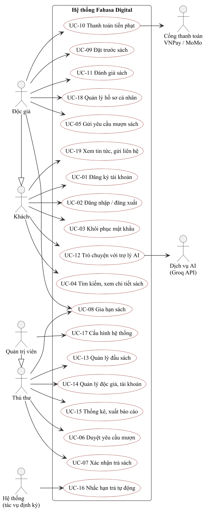

Để làm rõ hơn, em phân rã biểu đồ tổng quát theo từng phân hệ.

Hình 2.2 là biểu đồ use-case của phân hệ độc giả. Các ca mượn, gia hạn, đặt trước, thanh toán và đánh giá đều *bao gồm* (include) ca đăng nhập, vì chỉ người dùng đã xác thực mới thực hiện được. Thanh toán qua VNPay và MoMo là hai *mở rộng* (extend) của ca thanh toán tiền phạt.

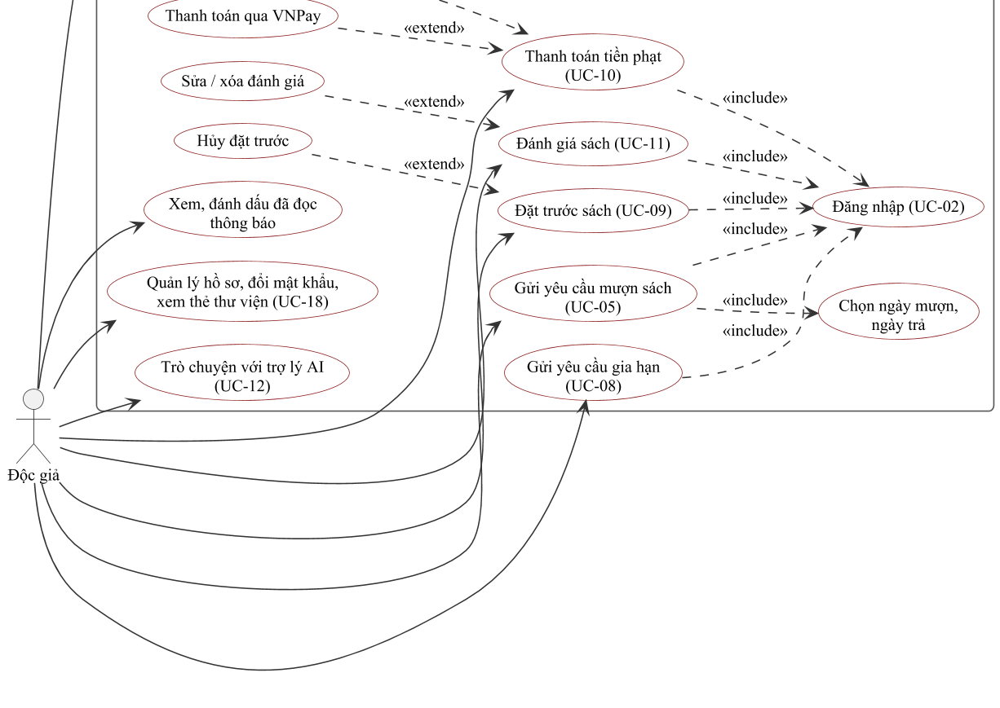

Hình 2.3 là biểu đồ use-case của phân hệ thủ thư. Ca "Xác nhận trả sách" luôn bao gồm ba bước: ghi nhận tình trạng sách, tự động tạo phiếu phạt và thông báo người đầu hàng chờ. Đây chính là điểm tự động hóa giúp giải quyết các vấn đề VĐ-03 và VĐ-04.

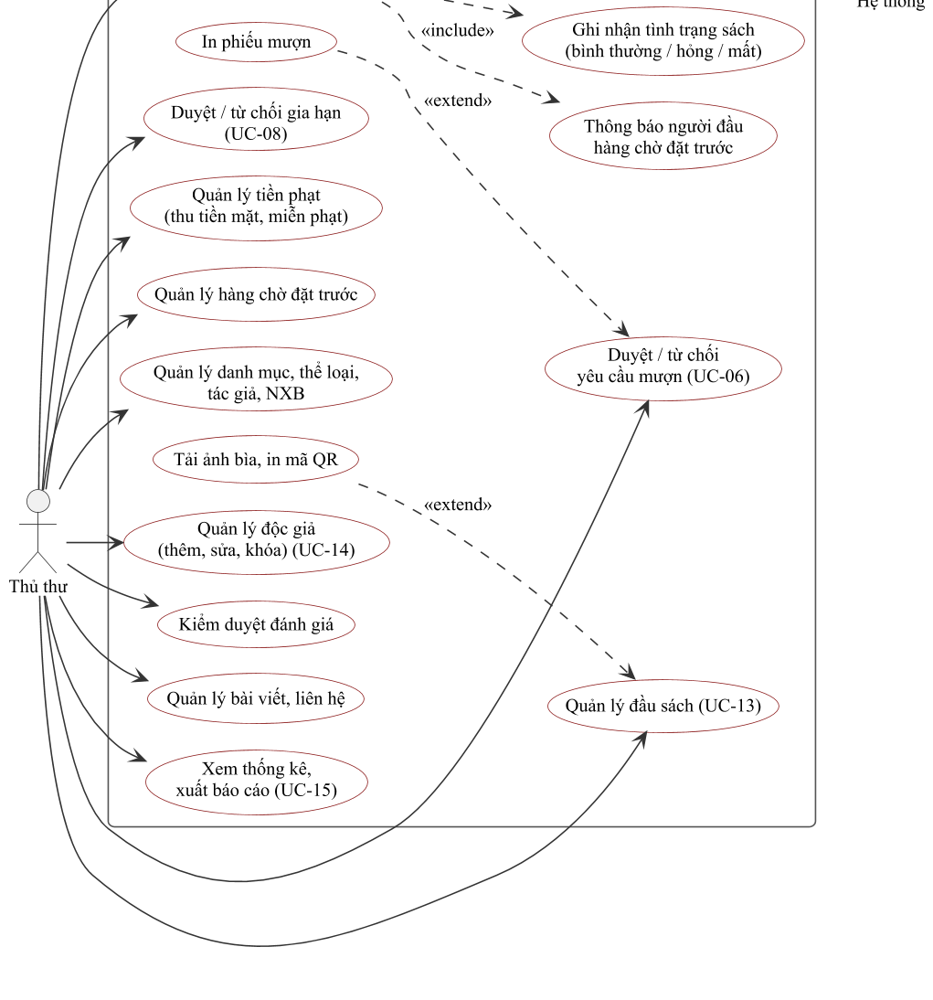

Hình 2.4 trình bày các ca sử dụng chỉ dành cho Quản trị viên (quản lý tài khoản, xóa dữ liệu danh mục, cấu hình hệ thống) và ca nhắc hạn tự động do Hệ thống thực hiện.

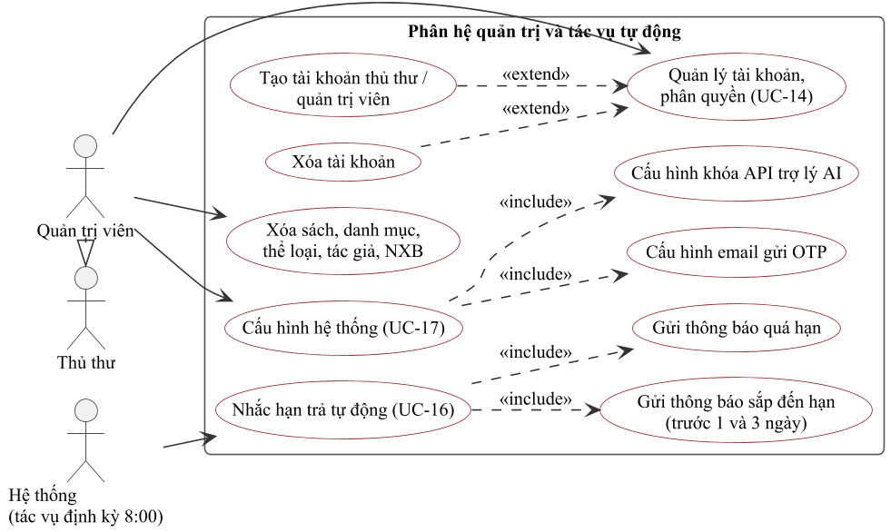

Mã nguồn PlantUML của toàn bộ biểu đồ trong báo cáo được lưu trong thư mục `BaoCao/diagrams`.

### 2.4.3 Mô hình lớp và đối tượng

**Biểu đồ lớp thực thể.** Hình 2.5 trình bày các lớp thực thể của hệ thống, tương ứng một – một với các model Sequelize trong thư mục `server/src/models`. Các quan hệ được khai báo trong tệp `models/index.js`. Để biểu đồ gọn, em lược bỏ các thuộc tính kỹ thuật chung là `id`, `createdAt`, `updatedAt` ở một số lớp, cùng các lớp phụ trợ không tham gia nghiệp vụ chính (`Contact`, `SystemConfig`, `Otp`).

<!-- landscape -->

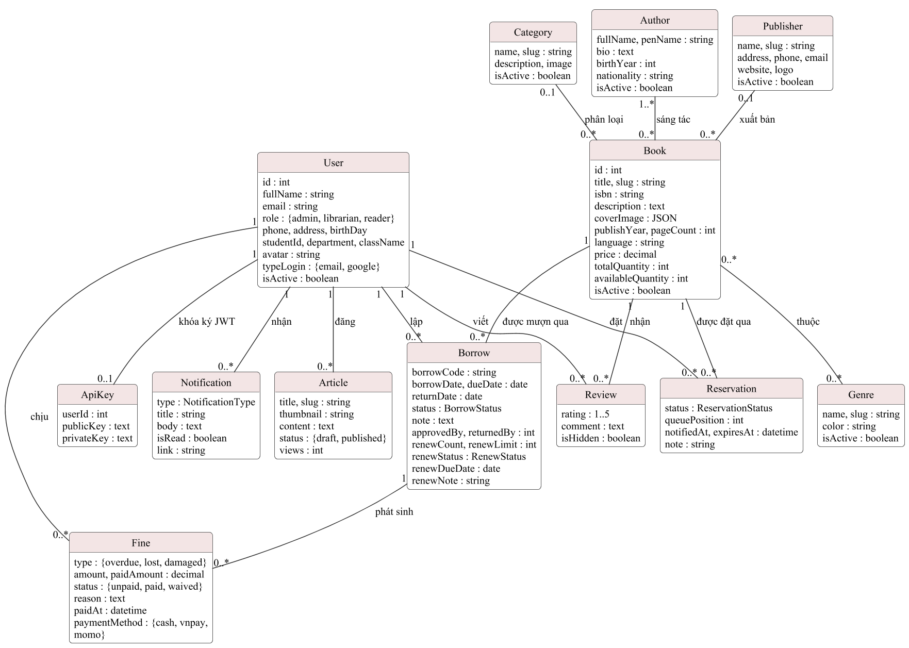

<!-- portrait -->

Ý nghĩa của các lớp chính được tóm tắt trong Bảng 2.32.

**Bảng 2.32: Các lớp thực thể chính**

| Lớp | Ý nghĩa | Thuộc tính / ràng buộc đáng chú ý |
|---|---|---|
| `User` | Người dùng của hệ thống (độc giả, thủ thư, quản trị viên) | `role` quyết định quyền; `isActive = false` là tài khoản bị khóa; `typeLogin` phân biệt tài khoản email và Google; `password` lưu dạng băm |
| `ApiKey` | Cặp khóa RSA dùng để ký và xác minh JWT của từng người dùng | Bị xóa khi đăng xuất, nên mọi token cũ mất hiệu lực ngay |
| `Book` | Đầu sách | `availableQuantity` là số bản còn có thể cho mượn; `coverImage` là mảng JSON chứa nhiều ảnh; `isActive` để ẩn/hiện |
| `Category`, `Genre`, `Author`, `Publisher` | Danh mục, thể loại, tác giả, nhà xuất bản | Sách có một danh mục, một nhà xuất bản; quan hệ nhiều – nhiều với tác giả và thể loại qua hai bảng trung gian `book_authors`, `book_genres` |
| `Borrow` | Phiếu mượn – lớp trung tâm của nghiệp vụ | `status` theo vòng đời ở Hình 2.10; `renewStatus`, `renewCount`, `renewLimit` quản lý gia hạn; `approvedBy`, `returnedBy` lưu người xử lý |
| `Fine` | Phiếu phạt phát sinh từ một phiếu mượn | `type` (quá hạn, hư hỏng, mất); `status` (chưa nộp, đã nộp, được miễn); `paymentMethod` (tiền mặt, VNPay, MoMo) |
| `Reservation` | Lượt đặt trước sách đã hết | `queuePosition` là vị trí trong hàng chờ; `expiresAt` là hạn giữ chỗ 48 giờ |
| `Review` | Đánh giá sách | Mỗi cặp (độc giả, sách) có tối đa một đánh giá; `isHidden` dùng cho kiểm duyệt |
| `Notification` | Thông báo trong ứng dụng | `type` gồm 12 loại (duyệt mượn, từ chối, gia hạn, đặt trước có sách, sắp đến hạn, quá hạn, phiếu phạt mới…); `isRead` |

**Biểu đồ lớp tầng nghiệp vụ.** Hình 2.6 minh họa cách các lớp xử lý phối hợp với nhau, lấy nghiệp vụ mượn – trả làm ví dụ. Yêu cầu HTTP đi qua route và middleware phân quyền, sau đó tới controller, rồi tới service. `BorrowService` gọi `FineService` để tạo phiếu phạt, gọi `ReservationService` để xử lý hàng chờ và gọi `NotificationService` để gửi thông báo. Cách tách lớp này giúp mỗi quy tắc nghiệp vụ nằm ở đúng một nơi, đáp ứng NFR-12.

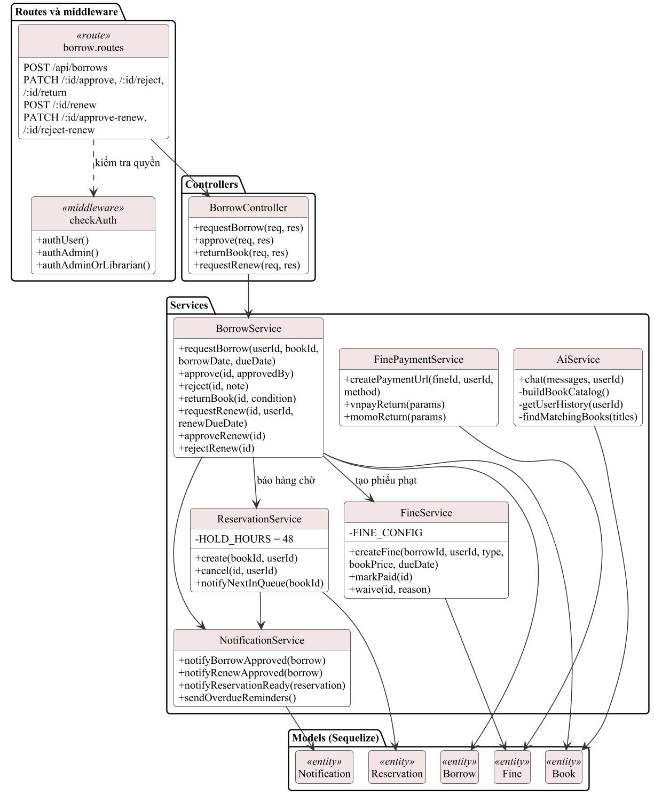

**Mô hình dữ liệu quan hệ.** Từ biểu đồ lớp, Sequelize sinh ra các bảng trong MySQL. Em chia lược đồ quan hệ (ERD) thành hai phần để dễ theo dõi:

- Hình 2.7 là phần danh mục sách, gồm hai bảng trung gian hiện thực quan hệ nhiều – nhiều.
- Hình 2.8 là phần nghiệp vụ mượn – trả và người dùng.

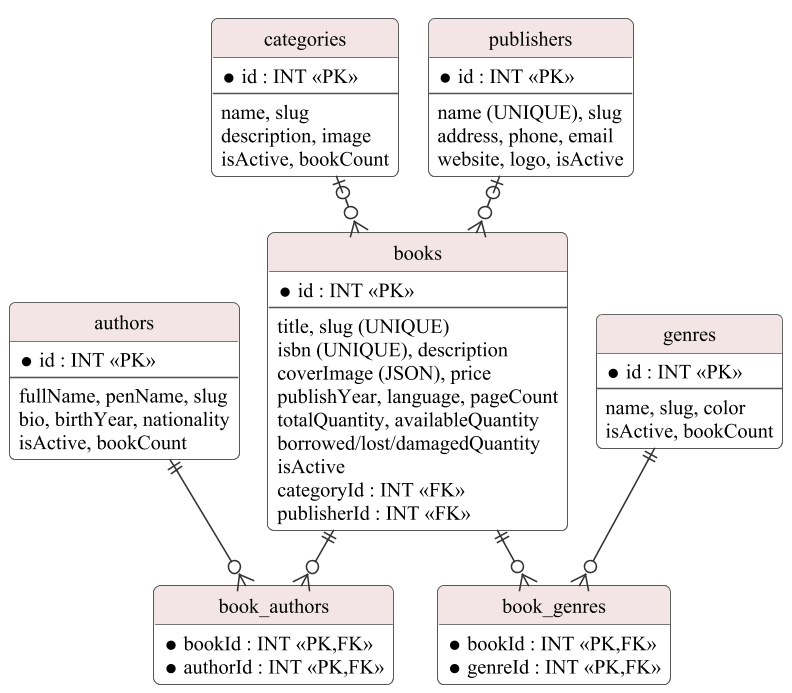

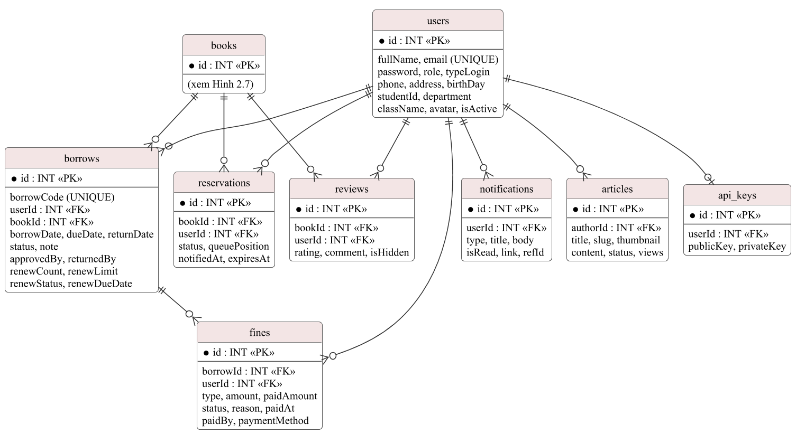

**Biểu đồ đối tượng.** Hình 2.9 là một ảnh chụp trạng thái của hệ thống, lấy từ dữ liệu thử nghiệm. Độc giả `minhAnh` đã mượn sách "Khế Ước Bán Dâu" với hạn trả 15/9/2026 và trả trễ 21 ngày. Hệ thống tự sinh phiếu phạt quá hạn 42.000 đồng, sau đó thủ thư xác nhận đã thu tiền mặt. Biểu đồ đối tượng giúp kiểm tra rằng các quan hệ trong biểu đồ lớp đủ để biểu diễn một tình huống nghiệp vụ hoàn chỉnh.

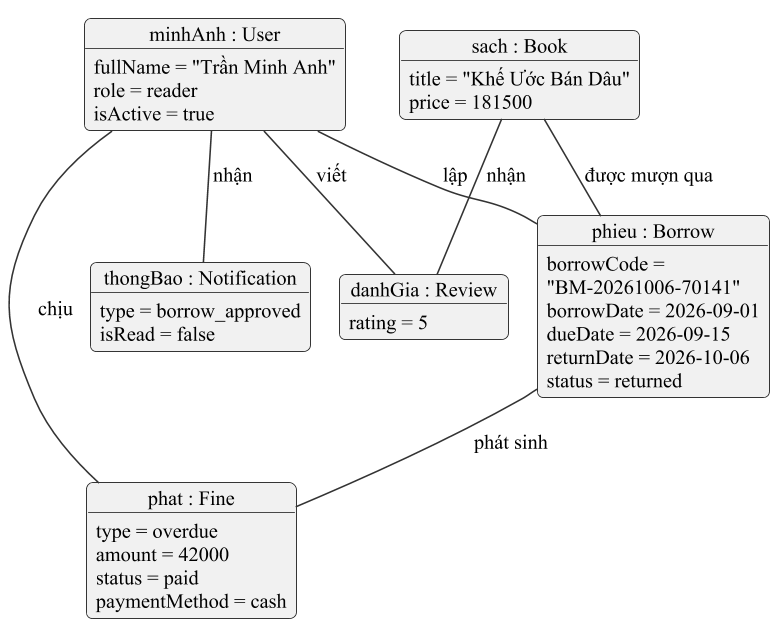

**Biểu đồ trạng thái.** Vì phiếu mượn là đối tượng có vòng đời phức tạp nhất, em dùng biểu đồ trạng thái để mô tả chính xác các chuyển trạng thái được phép (Hình 2.10). Từ `pending`, phiếu chỉ có thể chuyển sang `approved` hoặc `rejected`. Từ `approved` hoặc `overdue`, phiếu có thể được gia hạn, trả hoặc báo mất. Các trạng thái `rejected`, `returned` và `lost` là trạng thái kết thúc. Mọi phương thức trong `BorrowService` đều kiểm tra trạng thái hiện tại trước khi chuyển; một yêu cầu không hợp lệ (ví dụ duyệt lại một phiếu đã duyệt) sẽ bị từ chối với mã lỗi 400.

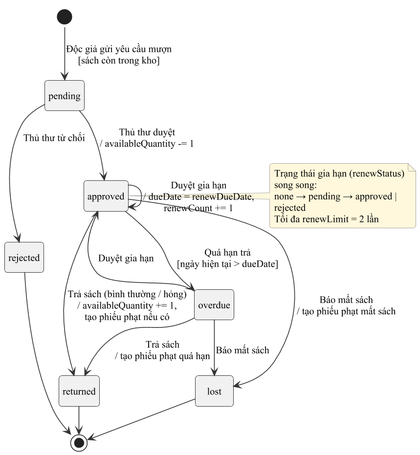

Tương tự, Hình 2.11 mô tả vòng đời của lượt đặt trước và của phiếu phạt.

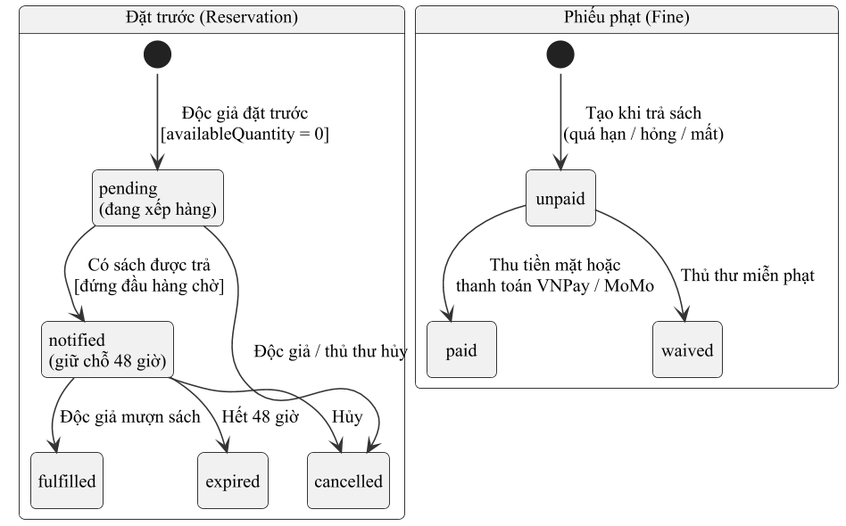

### 2.4.4 Các biểu đồ tuần tự

Em chọn năm ca sử dụng quan trọng nhất để mô tả bằng biểu đồ tuần tự. Đó là các ca liên quan đến bảo mật (đăng nhập), nghiệp vụ cốt lõi (mượn – duyệt, trả sách) và tích hợp với hệ thống bên ngoài (thanh toán, trợ lý AI).

**Đăng nhập (UC-02).** Hình 2.12 cho thấy điểm đặc biệt trong cơ chế xác thực của hệ thống. Thay vì dùng một khóa bí mật chung, mỗi lần đăng nhập máy chủ sinh một cặp khóa RSA-2048 riêng cho người dùng và lưu vào bảng `api_keys`. Token được ký bằng khóa riêng theo thuật toán RS256. Khi kiểm tra token, middleware giải mã phần thân để lấy mã người dùng, rồi xác minh chữ ký bằng khóa công khai tương ứng. Khi đăng xuất, cặp khóa bị xóa nên mọi token đã cấp đều mất hiệu lực ngay, kể cả khi chưa hết hạn.

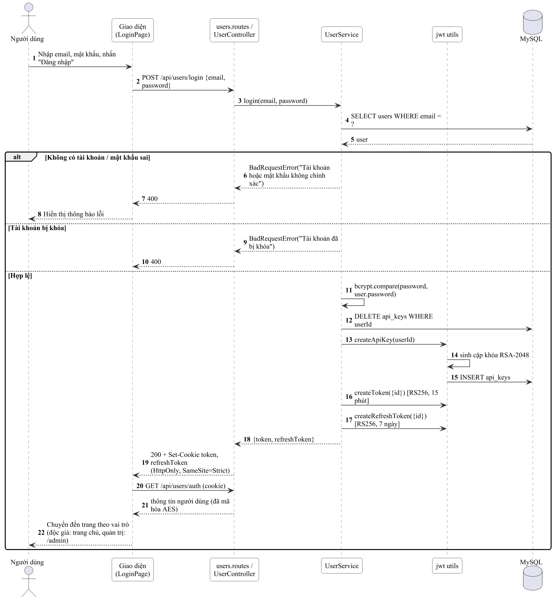

**Gửi và duyệt yêu cầu mượn (UC-05, UC-06).** Hình 2.13 gồm hai giai đoạn. Ở giai đoạn đầu, phiếu được tạo ở trạng thái chờ duyệt và kho sách chưa thay đổi. Kho chỉ bị trừ khi thủ thư duyệt. Thiết kế này tránh việc một yêu cầu bị bỏ quên làm "giữ chỗ" sách vô thời hạn. Tại mỗi bước, hệ thống kiểm tra lại số lượng còn trong kho để phát hiện trường hợp sách vừa được người khác mượn hết.

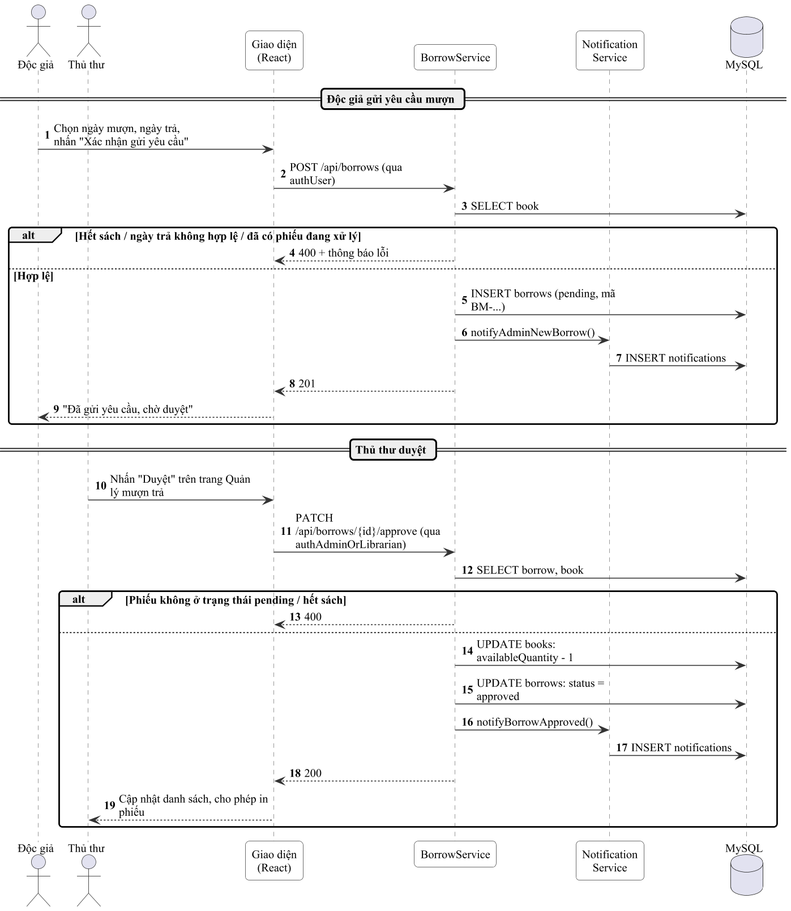

**Xác nhận trả sách (UC-07).** Hình 2.14 thể hiện chuỗi xử lý tự động khi thủ thư xác nhận trả sách: cập nhật kho, đóng phiếu, tính và tạo phiếu phạt theo tình trạng sách, rồi chuyển lượt cho người đầu hàng chờ đặt trước. Công thức tính phạt được ghi chú trực tiếp trên biểu đồ.

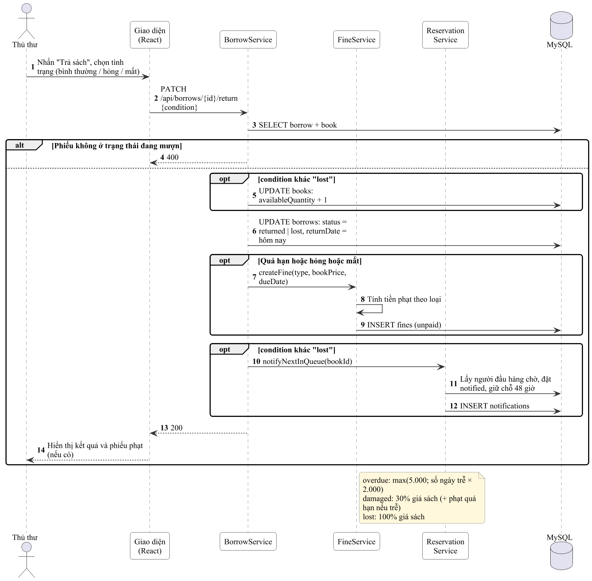

**Thanh toán tiền phạt qua VNPay (UC-10).** Hình 2.15 mô tả luồng chuyển hướng giữa giao diện, máy chủ và cổng VNPay. URL thanh toán được ký bằng HMAC-SHA512 với khóa bí mật của đơn vị bán hàng. Ở chiều ngược lại, khi VNPay chuyển hướng về, máy chủ cần kiểm tra chữ ký `vnp_SecureHash` trước khi tin vào mã kết quả. Mục 4.1 sẽ trình bày kết quả kiểm thử điểm này.

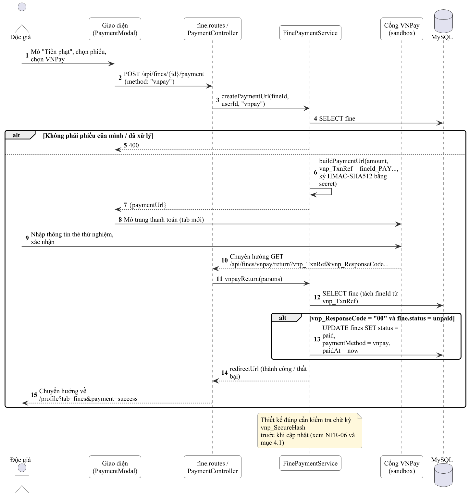

**Trò chuyện với trợ lý AI (UC-12).** Hình 2.16 mô tả kỹ thuật bổ sung ngữ cảnh mà em áp dụng. Trước mỗi lần gọi mô hình ngôn ngữ lớn, máy chủ truy vấn cơ sở dữ liệu để lấy danh mục sách thật và lịch sử mượn của độc giả, rồi đưa vào lời nhắc hệ thống. Lời nhắc yêu cầu mô hình chỉ gợi ý sách trong danh mục và trả về danh sách tiêu đề ở dòng `SUGGESTED_BOOKS`. Máy chủ đối chiếu các tiêu đề này với cơ sở dữ liệu để hiển thị thẻ sách thật, nên người dùng có thể bấm vào để mượn ngay.

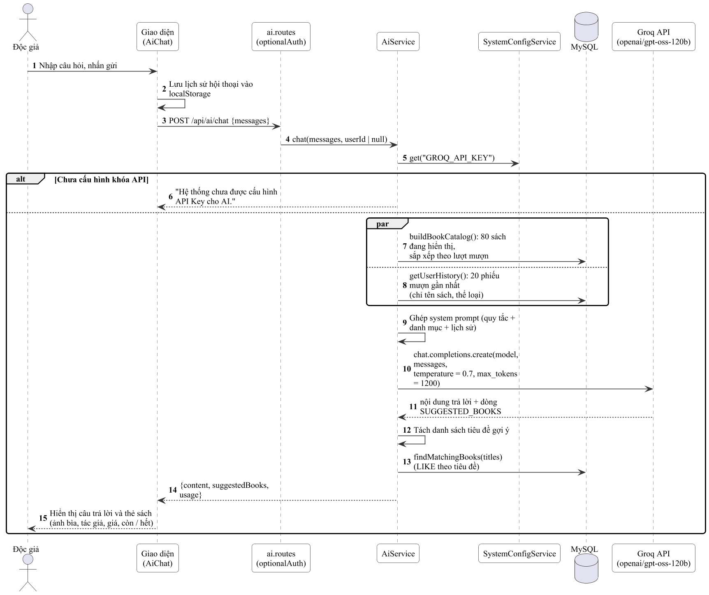

**Biểu đồ hoạt động.** Để thể hiện rõ sự phân luồng công việc giữa độc giả, thủ thư và hệ thống, em bổ sung ba biểu đồ hoạt động có làn (swimlane):

- Hình 2.17: quy trình từ khi độc giả tìm sách đến khi phiếu được duyệt hoặc từ chối.
- Hình 2.18: quy trình gia hạn, trả sách và xử lý phạt.
- Hình 2.19: quy trình đặt trước khi sách đã hết.

So với quy trình thủ công ở Hình 1.1, các bước tra sổ, tự tính tiền phạt và hẹn độc giả quay lại đều được thay bằng các hoạt động tự động của hệ thống.

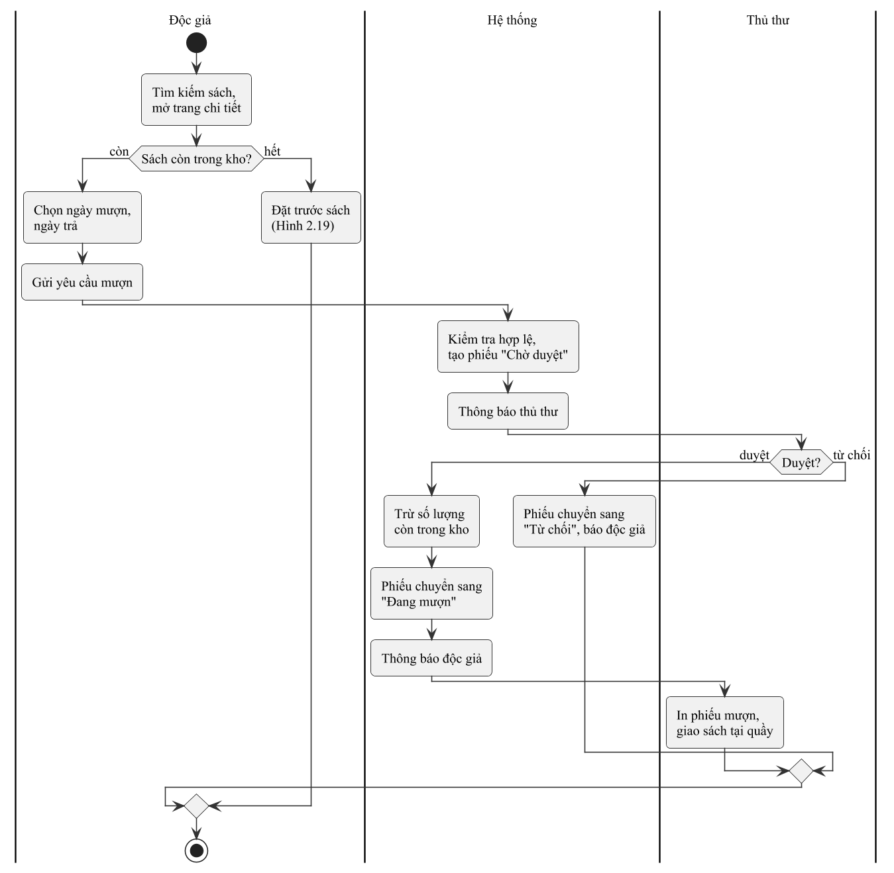

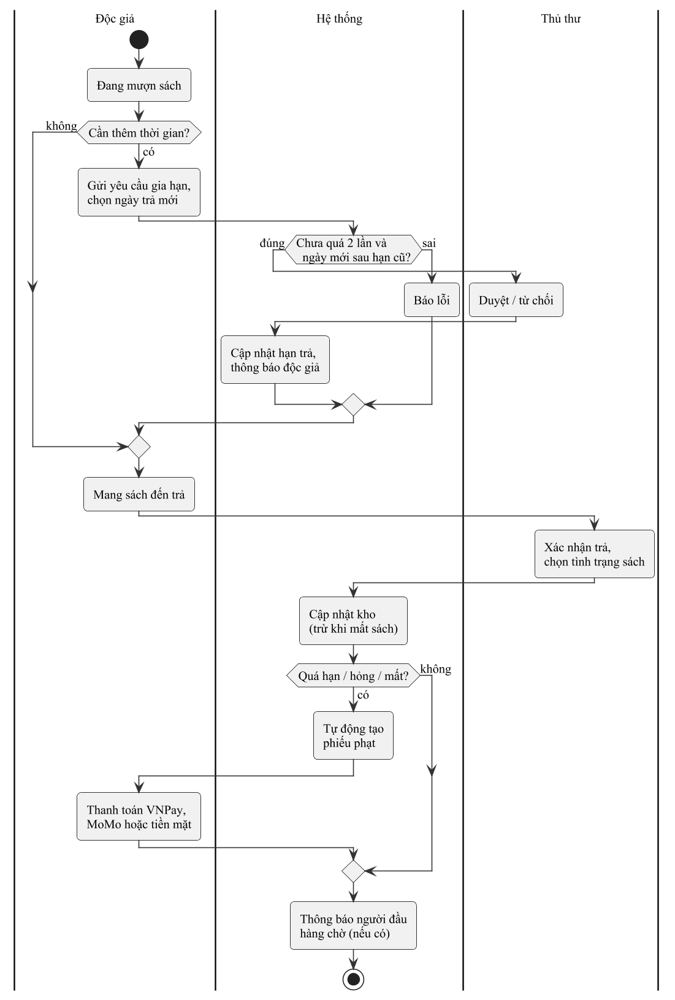

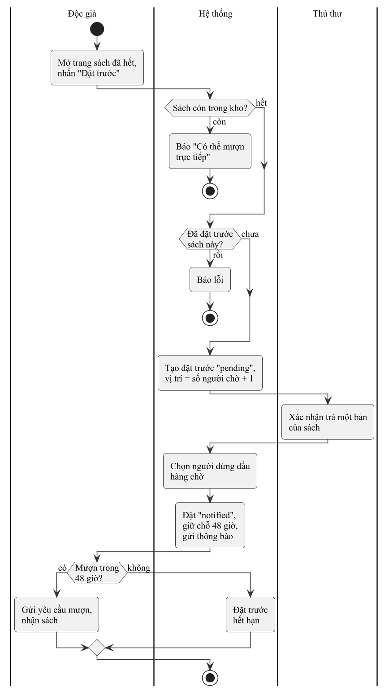

### 2.4.5 Các màn hình giao diện người dùng

Giao diện được xây dựng bằng React với thư viện Ant Design và Tailwind CSS, theo tông màu đỏ đậm của thương hiệu. Hệ thống gồm hai bố cục:

- **Bố cục công khai:** thanh điều hướng phía trên và chân trang, dành cho Khách và Độc giả.
- **Bố cục quản trị:** thanh menu bên trái, dùng chung cho Thủ thư (đường dẫn `/staff/...`) và Quản trị viên (đường dẫn `/admin/...`).

Bảng 2.33 liệt kê toàn bộ màn hình chính cùng ca sử dụng tương ứng. Để báo cáo gọn, em chỉ trình bày ảnh của 14 màn hình minh họa trực tiếp các ca sử dụng cốt lõi; các màn hình còn lại có cấu trúc tương tự và được liệt kê trong bảng.

Toàn bộ ảnh màn hình dưới đây được em chụp trực tiếp từ hệ thống chạy bằng Docker trên máy cục bộ. Dữ liệu trong ảnh gồm:

- Dữ liệu sách lấy từ các tệp seed có sẵn trong mã nguồn.
- Ảnh bìa minh họa do em tự tạo bằng chương trình.
- Các tài khoản và giao dịch thử nghiệm (độc giả "Trần Minh Anh", "Lê Hoàng Nam", "Phạm Thu Trang", thủ thư "Nguyễn Thu Hà"). Đây là dữ liệu giả lập, không phải người dùng thật.

**Bảng 2.33: Danh sách màn hình chính**

| Màn hình | Đường dẫn | Người dùng | Ca sử dụng | Hình |
|---|---|---|---|---|
| Trang chủ | `/` | Khách, Độc giả | UC-04, UC-19 | – |
| Đăng nhập, Đăng ký, Quên mật khẩu | `/login`, `/register` | Khách | UC-01 – UC-03 | 2.20 |
| Tìm kiếm sách | `/search` | Khách, Độc giả | UC-04 | 2.21 |
| Chi tiết sách, gửi yêu cầu mượn, đánh giá | `/books/:id` | Khách, Độc giả | UC-04, UC-05, UC-11 | 2.22, 2.23 |
| Đặt trước, sách đã đặt trước | `/books/:id`, `/my/reservations` | Độc giả | UC-09 | 2.24 |
| Lịch sử mượn, gia hạn | `/my/borrows` | Độc giả | UC-05, UC-08 | 2.25 |
| Hồ sơ, thẻ thư viện | `/profile` | Độc giả | UC-18 | 2.26 |
| Tiền phạt, thanh toán trực tuyến | `/profile` (mục Tiền phạt) | Độc giả | UC-10 | 2.27 |
| Thông báo | (biểu tượng chuông) | Mọi người dùng đã đăng nhập | UC-16 | – |
| Trợ lý AI | `/ai-chat` | Khách, Độc giả | UC-12 | 2.28 |
| Tin tức, Liên hệ | `/articles`, `/contact` | Khách, Độc giả | UC-19 | – |
| Tổng quan (dashboard) | `/admin`, `/staff` | Thủ thư, Quản trị viên | UC-15 | 2.29 |
| Quản lý sách, thêm sách | `/admin/books`, `/admin/books/new` | Thủ thư | UC-13 | 2.30 |
| Thể loại, Tác giả (tương tự Danh mục, Nhà xuất bản) | `/admin/genres`, `/admin/authors` | Thủ thư | UC-13 | – |
| Quản lý mượn trả | `/admin/borrows` | Thủ thư | UC-06, UC-07, UC-08 | 2.31 |
| Quản lý tiền phạt | `/admin/fines` | Thủ thư | UC-07, UC-10 | 2.32 |
| Quản lý người dùng | `/admin/readers` | Thủ thư, Quản trị viên | UC-14 | – |
| Kiểm duyệt đánh giá, Bài viết | `/admin/reviews`, `/admin/articles` | Thủ thư | UC-11, UC-19 | – |
| Báo cáo thống kê | `/admin/reports` | Thủ thư | UC-15 | 2.33 |
| Cấu hình hệ thống | `/admin/configs` | Quản trị viên | UC-17 | – |

#### Phân hệ khách và độc giả

**Đăng nhập (Hình 2.20, UC-02).** Màn hình gồm email, mật khẩu, liên kết "Quên mật khẩu?" (UC-03) và đường dẫn sang trang đăng ký (UC-01). Trang đăng ký thu thập họ tên, số điện thoại, mã thành viên, khoa/đơn vị, email và mật khẩu (nhập hai lần).

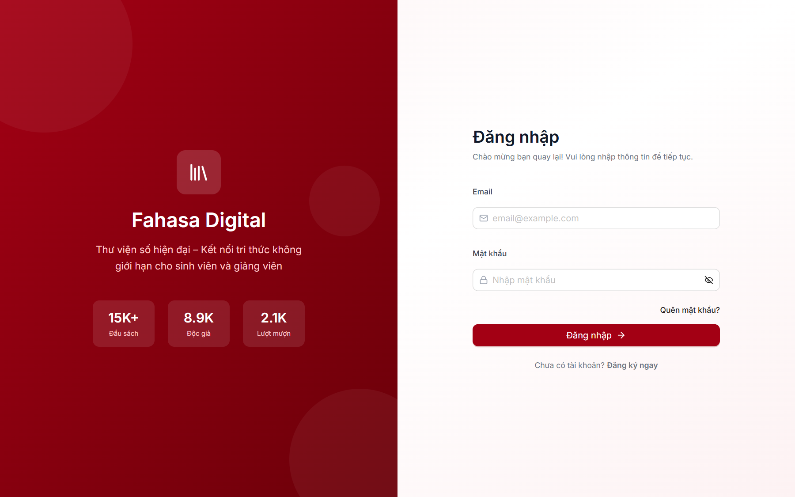

**Tìm kiếm sách (Hình 2.21, UC-04).** Ô tìm kiếm nhận tên sách, ISBN hoặc tác giả. Cột bộ lọc bên trái cho phép chọn danh mục, thể loại, nhà xuất bản, khoảng năm xuất bản và bật "Chỉ sách còn để mượn". Kết quả hiển thị dạng lưới, kèm số bản còn trên tổng số bản và có thể sắp xếp theo mới nhất, tên sách, năm xuất bản.

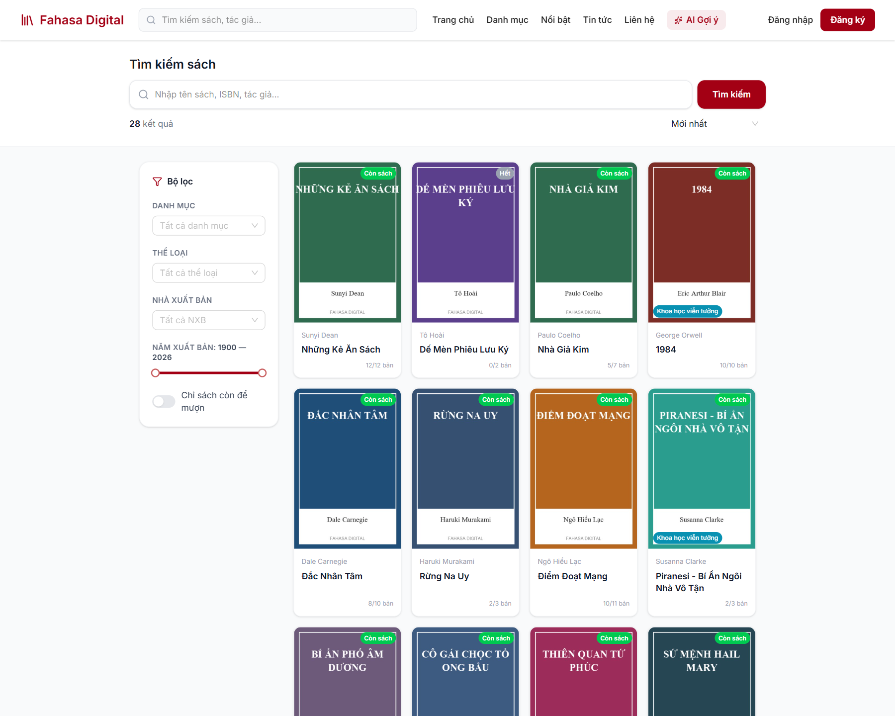

**Chi tiết sách và gửi yêu cầu mượn (Hình 2.22, Hình 2.23; UC-04, UC-05, UC-11).** Trang chi tiết gồm:

- Ảnh bìa (hỗ trợ nhiều ảnh) và thông tin sách.
- Ô trạng thái "Còn N bản / Tổng M bản trong kho".
- Nút "Gửi yêu cầu mượn" và nút xem mã QR.
- Phần "Đánh giá & Nhận xét" hiển thị điểm trung bình, phân bố số sao và từng nhận xét; nhận xét của chính người dùng được đánh dấu "Của bạn" và có nút sửa, xóa.

Khi nhấn "Gửi yêu cầu mượn", hộp thoại chọn ngày mượn và ngày trả xuất hiện (Hình 2.23). Như vậy, độc giả chỉ cần ba thao tác để gửi yêu cầu (NFR-09).

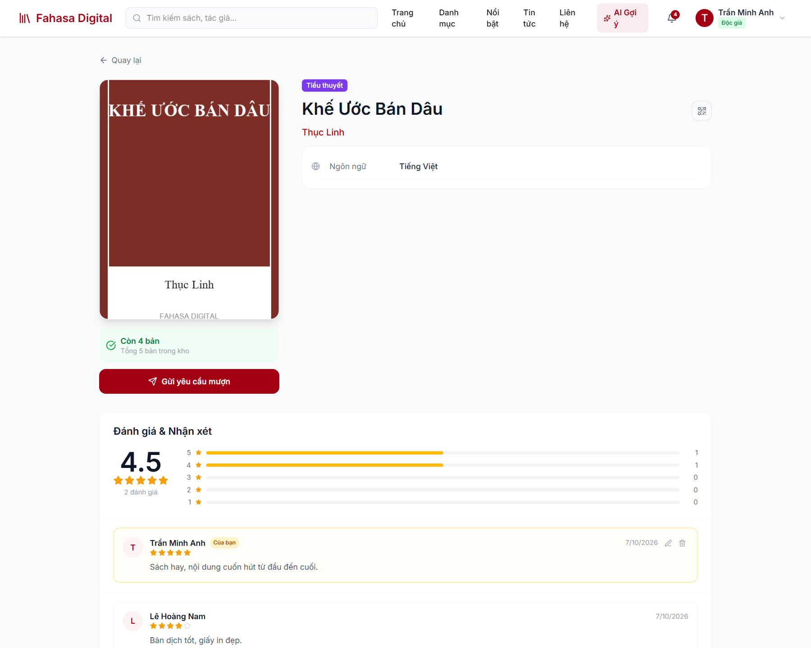

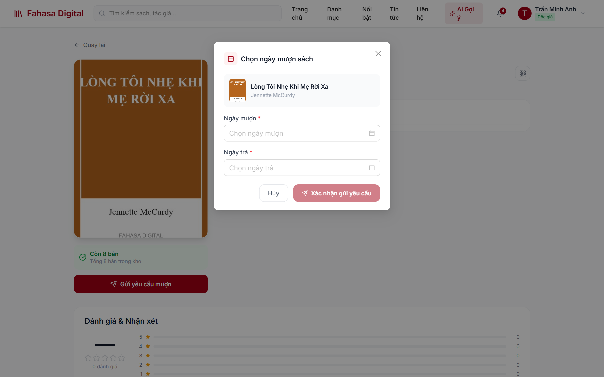

**Đặt trước sách (Hình 2.24, UC-09).** Với sách đã hết, trang chi tiết hiển thị "Hết sách" thay cho nút mượn. Sau khi đặt trước, độc giả thấy vị trí của mình ("Đang chờ – Vị trí #1"), số người đang chờ và nút "Hủy đặt trước". Trang "Sách đã đặt trước" tổng hợp các lượt đặt trước theo trạng thái.

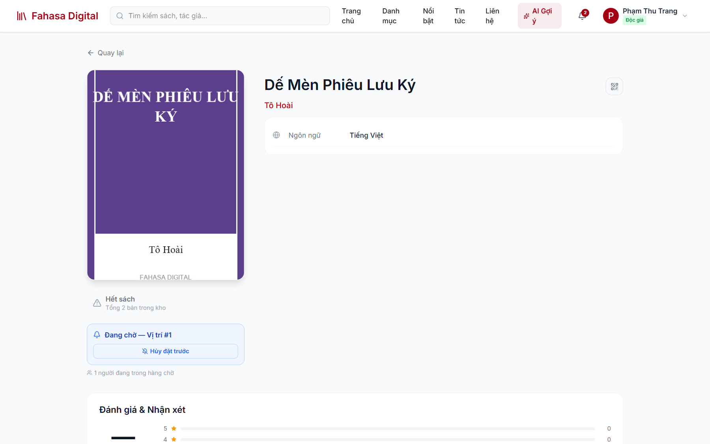

**Lịch sử mượn (Hình 2.25; UC-05, UC-08)** gồm các chỉ số tổng hợp, các tab lọc theo trạng thái và danh sách phiếu mượn; mỗi phiếu ghi mã phiếu, ngày mượn, hạn trả và trạng thái (chờ duyệt, đang mượn, đã trả, mất sách, từ chối). Từ đây độc giả gửi yêu cầu gia hạn cho phiếu đang mượn.

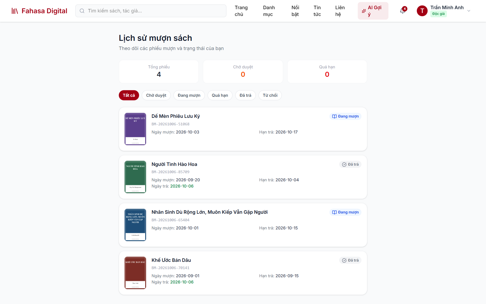

**Hồ sơ cá nhân và tiền phạt (Hình 2.26, Hình 2.27; UC-18, UC-10).** Trang hồ sơ có menu bên trái với bốn mục: Thông tin cá nhân, Thẻ thư viện, Lịch sử mượn, Tiền phạt.

- **Thông tin cá nhân:** hiển thị số sách đang mượn, số phiếu quá hạn và tổng tiền phạt chưa nộp, kèm nút chỉnh sửa thông tin.
- **Thẻ thư viện:** dạng thẻ điện tử, để xuất trình khi mượn hoặc trả sách tại quầy.
- **Tiền phạt:** liệt kê từng phiếu phạt theo loại (quá hạn, hư hỏng, mất sách), kèm nút thanh toán trực tuyến cho các phiếu chưa nộp.

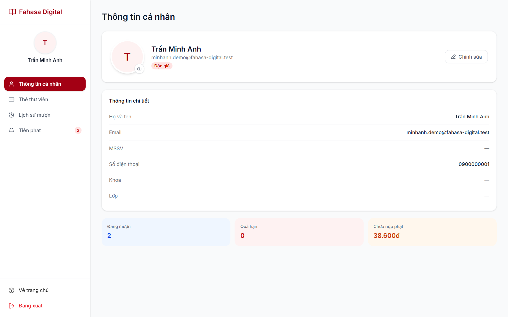

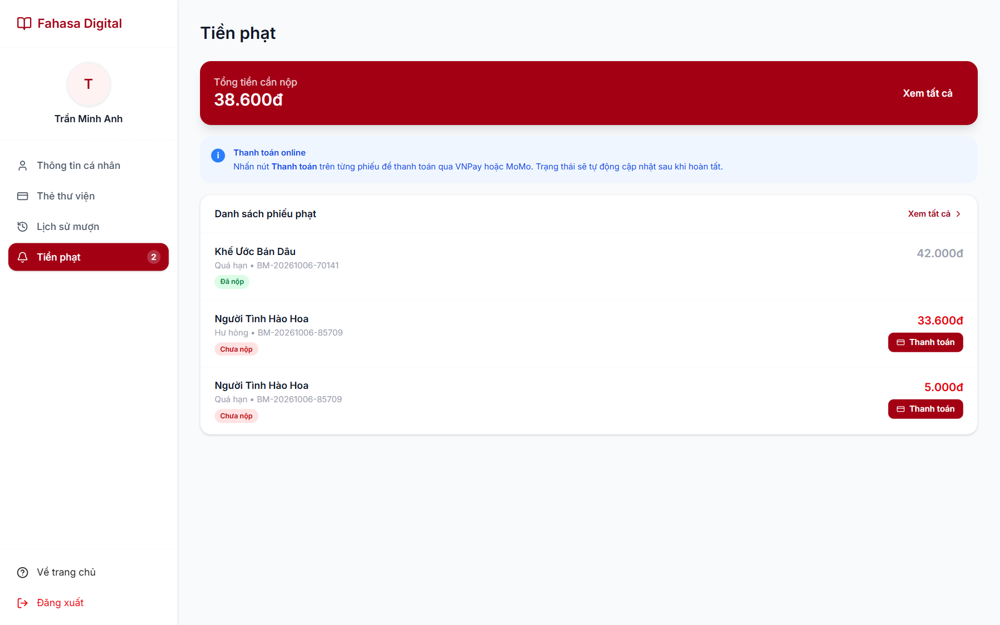

**Thông báo (UC-16).** Biểu tượng chuông trên thanh điều hướng hiển thị số thông báo chưa đọc. Khi mở, danh sách thông báo thả xuống với biểu tượng theo từng loại, nút "Đọc tất cả" và liên kết tới đối tượng liên quan (phiếu mượn, sách, phiếu phạt).

**Trợ lý AI gợi ý sách (Hình 2.28, UC-12).** Giao diện dạng hội thoại, có danh sách cuộc trò chuyện bên trái và các câu hỏi gợi ý sẵn. Hình 2.28 là kết quả thật khi em hỏi "Gợi ý cho mình vài cuốn văn học Việt Nam phù hợp để đọc cuối tuần". Trợ lý trả lời bằng tiếng Việt, gợi ý bốn sách có trong thư viện, và giao diện hiển thị bốn thẻ sách tương ứng với ảnh bìa, tác giả, giá và nhãn "Có sẵn". Phía dưới ô nhập có dòng lưu ý rằng AI có thể đưa ra thông tin chưa chính xác.

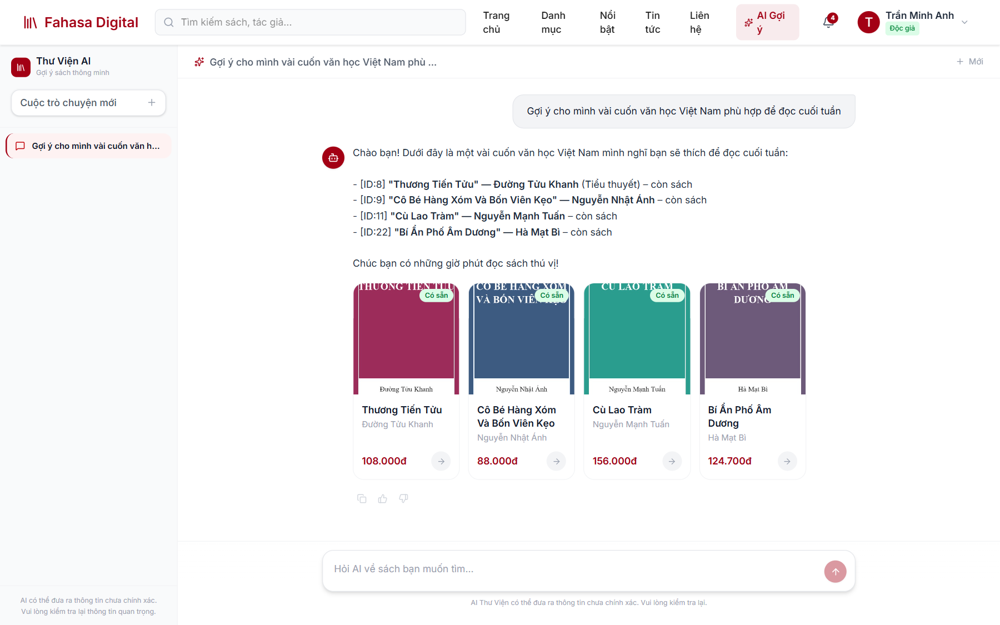

#### Phân hệ quản trị

Thủ thư và Quản trị viên dùng chung bố cục quản trị; menu của Thủ thư được rút gọn và không có các chức năng dành riêng cho Quản trị viên.

**Tổng quan (Hình 2.29, UC-15).** Đây là màn hình đầu tiên sau khi Thủ thư hoặc Quản trị viên đăng nhập, gồm:

- Bốn ô chỉ số: tổng số bản sách, số sách đang mượn, số phiếu quá hạn, tổng tiền phạt đã thu.
- Biểu đồ cột lượt mượn và lượt trả trong 6 tháng.
- Biểu đồ tròn cơ cấu sách theo danh mục.
- Bảng "Top sách mượn nhiều" và "Top độc giả tích cực".
- Danh sách "Yêu cầu mượn sách mới nhất" với nút duyệt hoặc từ chối nhanh.

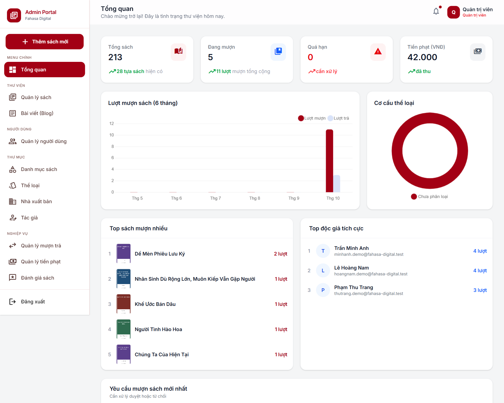

**Quản lý sách (Hình 2.30, UC-13).** Trang danh sách sách có ô tìm kiếm, bộ lọc, các chỉ số tổng hợp và bảng sách với số lượng còn/tổng, trạng thái hiển thị cùng các thao tác xem QR, sửa, ẩn/hiện, xóa. Biểu mẫu "Thêm sách mới" chia thành các khối: thông tin cơ bản; phân loại (danh mục, nhà xuất bản, tác giả, thể loại); ảnh bìa (kéo thả, tối đa 10 ảnh); giá và trạng thái hiển thị. Các màn hình quản lý danh mục, thể loại, tác giả, nhà xuất bản có cấu trúc giống nhau: ô tìm kiếm, nút thêm mới, bảng dữ liệu kèm số sách thuộc mỗi mục và các thao tác sửa, ẩn/hiện, xóa.

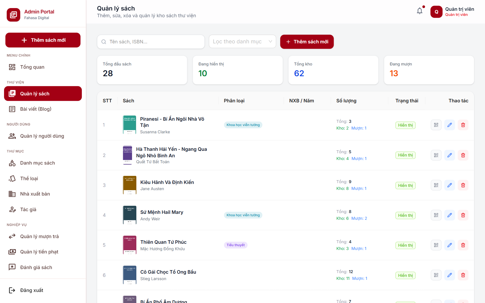

**Quản lý mượn trả (Hình 2.31; UC-06, UC-07, UC-08)** gồm:

- Bốn ô chỉ số: chờ duyệt, đang mượn, quá hạn, trả hôm nay.
- Ô tìm kiếm theo độc giả và bộ lọc trạng thái.
- Bảng phiếu mượn, với thao tác thay đổi theo trạng thái của phiếu:
  - Phiếu chờ duyệt: xem, duyệt, từ chối.
  - Phiếu đang mượn: in phiếu mượn, xem, xác nhận trả sách.
  - Phiếu có yêu cầu gia hạn: duyệt hoặc từ chối gia hạn.

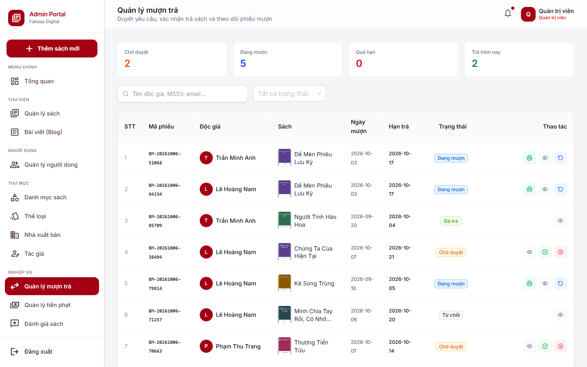

**Quản lý tiền phạt (Hình 2.32; UC-07, UC-10).** Bốn ô tổng hợp hiển thị số tiền chưa nộp, đã thu, được miễn và tổng phạt. Bảng phiếu phạt gồm loại phạt, số tiền, trạng thái, cùng hai nút "Đã thu" và "Miễn phạt" cho phiếu chưa nộp. Số tiền trong hình do hệ thống tự tính từ dữ liệu thử nghiệm:

- 42.000 đồng cho phiếu trả trễ 21 ngày.
- 33.600 đồng (30% của giá bìa 112.000 đồng) cho sách hư hỏng.
- 5.000 đồng (mức tối thiểu) cho phiếu trả trễ 2 ngày.
- 88.000 đồng (100% giá bìa) cho sách bị mất.

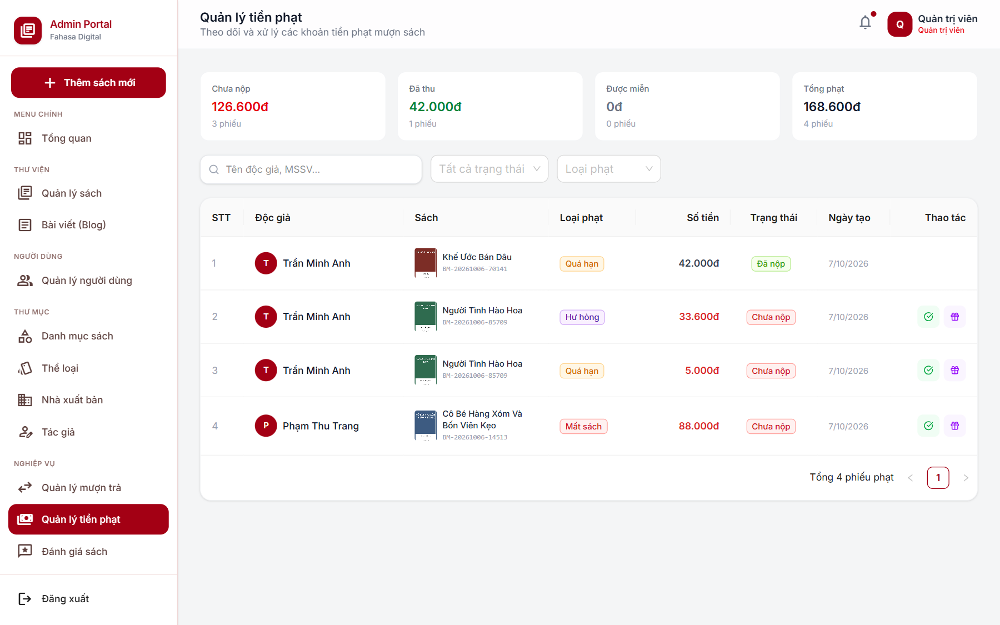

**Báo cáo thống kê (Hình 2.33, UC-15).** Năm loại báo cáo được trình bày dạng thẻ: danh sách đầu sách, danh sách độc giả, danh sách mượn trả, sách quá hạn, doanh thu tiền phạt. Mỗi thẻ có hai nút "Xuất Excel" và "Xuất PDF".

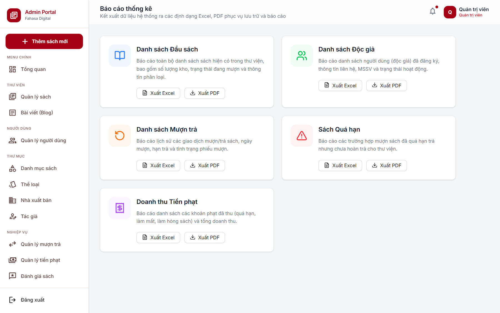

**Các màn hình quản trị khác.** Quản lý người dùng (UC-14), kiểm duyệt đánh giá và quản lý bài viết (UC-11, UC-19), cấu hình hệ thống (UC-17) dùng chung bố cục bảng dữ liệu kèm ô tìm kiếm, bộ lọc và các thao tác trên từng dòng. Màn hình cấu hình hệ thống dùng ô mật khẩu cho các trường bí mật.
