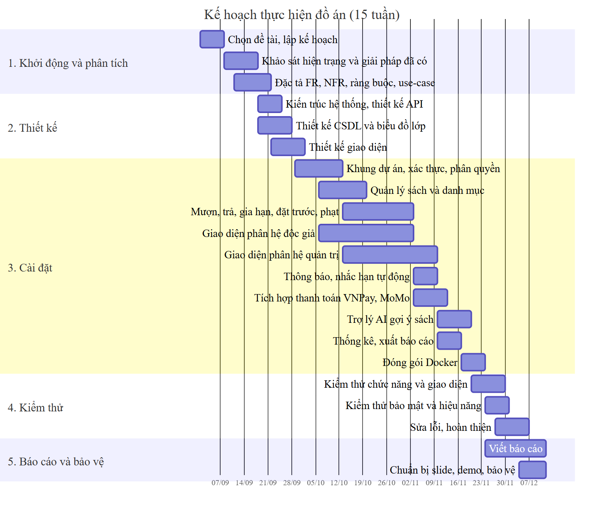

# 3. Một số thành phần khác của đồ án

## 3.1 Kế hoạch dự án

Đồ án được tổ chức theo năm giai đoạn trong khoảng 15 tuần: khởi động và phân tích, thiết kế, cài đặt, kiểm thử, báo cáo và bảo vệ. Giai đoạn cài đặt dài nhất và được chia theo các phân hệ chức năng, để phần backend và frontend được phát triển gối đầu lên nhau sau khi đã chốt thiết kế API (Bảng 2.10).

Bảng 3.1 liệt kê các công việc chính. Em không có số liệu ghi lại ngày thực tế của từng công việc. Vì vậy, các mốc thời gian dưới đây là khung kế hoạch 15 tuần mang tính minh họa, tính từ một ngày bắt đầu giả định. Mốc duy nhất có thể kiểm chứng trong mã nguồn là ngày khởi tạo kho Git của máy chủ (27/09/2025, commit "init").

**Bảng 3.1: Kế hoạch công việc của đồ án**

| STT | Công việc | Kết quả đầu ra | Thời gian (tuần) |
|---|---|---|---|
| 1 | Chọn đề tài, lập kế hoạch | Đề tài, kế hoạch công việc | 1 |
| 2 | Khảo sát hiện trạng và các giải pháp đã có | Mục 1.1, 1.2 | 2–3 |
| 3 | Đặc tả yêu cầu, ràng buộc, use-case | Mục 2.1–2.3, 2.4.1 | 2–4 |
| 4 | Thiết kế kiến trúc và API | Hình 1.2, Bảng 2.10 | 3–4 |
| 5 | Thiết kế cơ sở dữ liệu, biểu đồ lớp | Hình 2.5–2.8 | 3–4 |
| 6 | Thiết kế giao diện | Bản phác thảo giao diện | 4–5 |
| 7 | Khung dự án, xác thực, phân quyền | API `/api/users`, middleware `checkAuth` | 5–6 |
| 8 | Quản lý sách và danh mục | API và màn hình sách, danh mục, thể loại, tác giả, nhà xuất bản | 6–7 |
| 9 | Mượn, trả, gia hạn, đặt trước, phạt | `BorrowService`, `FineService`, `ReservationService` | 7–9 |
| 10 | Giao diện phân hệ độc giả | Các màn hình Hình 2.20–2.28 | 6–9 |
| 11 | Giao diện phân hệ quản trị | Các màn hình Hình 2.29–2.33 | 7–10 |
| 12 | Thông báo, nhắc hạn tự động | `NotificationService`, tác vụ 8:00 | 10 |
| 13 | Tích hợp thanh toán VNPay, MoMo | `FinePaymentService` | 10–11 |
| 14 | Trợ lý AI gợi ý sách | `AiService`, trang AI Gợi ý | 11–12 |
| 15 | Thống kê, xuất báo cáo | Trang Tổng quan, Báo cáo | 11 |
| 16 | Đóng gói Docker | `Dockerfile`, `docker-compose.yml` | 12 |
| 17 | Kiểm thử chức năng, bảo mật, hiệu năng | Mục 4.1 | 12–13 |
| 18 | Sửa lỗi, hoàn thiện | Phiên bản nộp | 13–14 |
| 19 | Viết báo cáo, chuẩn bị slide, demo | Báo cáo, slide | 13–15 |

Biểu đồ Gantt ở Hình 3.1 thể hiện trực quan trình tự và sự chồng lấn giữa các công việc. Biểu đồ được vẽ bằng Mermaid; mã nguồn lưu trong thư mục `BaoCao/diagrams`. Theo biểu đồ, giao diện độc giả và giao diện quản trị được phát triển song song với các service nghiệp vụ; kiểm thử bắt đầu trước khi cài đặt hoàn tất, và việc viết báo cáo bắt đầu ngay từ giai đoạn kiểm thử.

## 3.2 Quy trình và kỷ luật thực hiện đồ án

Đồ án do một mình em thực hiện, từ phân tích, thiết kế, cài đặt đến kiểm thử và viết báo cáo. Vì vậy, thách thức chính không nằm ở việc phối hợp giữa nhiều người, mà ở việc tự tổ chức công việc, giữ kỷ luật kỹ thuật và tự kiểm soát chất lượng khi không có người review chéo. Em áp dụng các công cụ và quy tắc làm việc trong Bảng 3.2.

**Bảng 3.2: Công cụ và quy tắc làm việc**

| Hạng mục | Công cụ / cách làm | Bằng chứng trong đồ án |
|---|---|---|
| Quản lý mã nguồn | Git quản lý phiên bản mã nguồn phần máy chủ | Thư mục `server/.git` |
| Thống nhất phong cách mã | Prettier định dạng mã tự động; ESLint kiểm tra mã phía giao diện; cấu hình VS Code dùng chung cho cả hai phân hệ | Tệp `.prettierrc`, `client/eslint.config.js`, `.vscode/settings.json` |
| Đồng nhất môi trường chạy | Docker Compose cố định phiên bản Node.js 20, MySQL 8.0, giúp môi trường phát triển và môi trường chạy thử luôn giống nhau | `docker-compose.yml`, các `Dockerfile` |
| Thống nhất giao tiếp giữa frontend và backend | Danh sách API, định dạng phản hồi thống nhất (`message`, `statusCode`, `metadata`) | `server/src/core/success.response.js`, `error.response.js` |

**Tự rà soát mã nguồn.** Vì không có người khác review, trước khi hoàn thành mỗi chức năng em tự kiểm tra theo danh sách sau:

1. Mã có đáp ứng đúng FR liên quan không.
2. Quy tắc nghiệp vụ có nằm trong tầng Service hay bị viết lẫn vào Controller.
3. API mới đã gắn đúng middleware phân quyền chưa.
4. Có lộ thông tin bí mật (khóa API, mật khẩu) trong mã hay không.

Kết quả kiểm thử ở Chương 4 cho thấy mục 3 và 4 chưa được tuân thủ đầy đủ: ở lần rà soát đầu, một số API chưa kiểm tra chữ ký của bên thứ ba, và một số khóa sandbox của cổng thanh toán vẫn được ghi cứng trong mã; em đã khắc phục cả hai điểm này sau đó. Đây là hạn chế dễ gặp khi chỉ có một người tự review: người viết mã thường bỏ sót chính những trường hợp mà mình chưa nghĩ tới. Em rút kinh nghiệm cần biến danh sách trên thành bước kiểm tra bắt buộc, đồng thời bổ sung công cụ quét mã tự động và kiểm thử tự động để bù cho việc thiếu người review chéo.

**Ra quyết định kỹ thuật.** Khi phải lựa chọn giữa nhiều giải pháp kỹ thuật, em xử lý theo các bước:

1. Liệt kê các phương án kèm ưu, nhược điểm.
2. Ưu tiên phương án đáp ứng yêu cầu đã đặc tả và đơn giản hơn, để dễ bảo trì.
3. Ghi lại lý do lựa chọn để có thể xem lại khi cần thay đổi.
4. Với vấn đề ảnh hưởng đến phạm vi hoặc tiến độ, em hỏi ý kiến giảng viên hướng dẫn.

Nhiệm vụ của em trong đồ án được tóm tắt ở bảng "Phân công thực hiện đồ án" đầu báo cáo; kế hoạch chi tiết theo tuần nằm ở Bảng 3.1.

## 3.3 Các vấn đề về đạo đức và làm việc chuyên nghiệp

**Bảo vệ dữ liệu người dùng.** Hệ thống lưu thông tin cá nhân và lịch sử mượn của độc giả. Em đã áp dụng các biện pháp:

- Băm mật khẩu và OTP bằng bcrypt.
- Không trả trường mật khẩu qua API.
- Cookie phiên đặt `HttpOnly` và `SameSite=Strict`.
- Chỉ gửi tên và thể loại sách cho dịch vụ AI.

Tuy nhiên, lần rà soát đầu tiên phát hiện một số lỗ hổng làm suy yếu các biện pháp trên, thuộc nhóm "Kiểm soát truy cập bị phá vỡ" (A01) và "Lỗi xác thực" (A07) trong danh sách OWASP Top 10:2025 [14]. Em đã khắc phục các lỗ hổng nghiêm trọng và kiểm thử lại (mục 4.1.3). Về mặt nghề nghiệp, em xác định chưa đưa hệ thống vào sử dụng với dữ liệu thật cho đến khi xử lý nốt các khiếm khuyết còn lại và triển khai HTTPS. Em cũng ghi nhận trung thực các lỗ hổng trong báo cáo thay vì che giấu. Khi vận hành thật, nhà sách còn phải đáp ứng Luật Bảo vệ dữ liệu cá nhân [13]: có điều khoản thu thập dữ liệu và sự đồng ý của độc giả, có cơ chế cho độc giả yêu cầu xóa dữ liệu.

**Trung thực trong sản phẩm.** Trang chủ hiển thị số độc giả là 500 (tệp `client/src/pages/Home/index.jsx`), và trang đăng nhập hiển thị "15K+ đầu sách", "8.9K độc giả", "2.1K lượt mượn". Các con số này được gán cứng trong mã nguồn, không phản ánh dữ liệu thật (dữ liệu thử nghiệm chỉ có 28 đầu sách và 3 độc giả). Hiển thị số liệu không có thật có thể khiến người dùng hiểu sai về quy mô dịch vụ. Em xác định cần thay bằng số liệu thật từ cơ sở dữ liệu hoặc bỏ đi.

**Bản quyền và giấy phép:**

- **Thư viện mã nguồn mở:** hệ thống dùng nhiều thư viện mã nguồn mở. Khi phân phối sản phẩm, em phải giữ nguyên thông báo bản quyền theo giấy phép của từng thư viện.
- **Dữ liệu sách:** tệp seed ghi chú danh sách tên sách và giá được lấy từ sàn thương mại điện tử Tiki. Dữ liệu này chỉ dùng cho mục đích học tập; khi vận hành thật, nhà sách phải dùng dữ liệu của chính mình.
- **Ảnh bìa:** ảnh bìa trong báo cáo do em tự tạo.
- **Thương hiệu:** tên "Fahasa" là thương hiệu của Công ty Cổ phần Phát hành sách TP.HCM. Em chỉ dùng tên này làm tên demo trong khuôn khổ đồ án học tập. Nếu triển khai công khai, em phải đổi tên hoặc được sự đồng ý của chủ sở hữu thương hiệu.

**Trích dẫn.** Mọi thông tin về các hệ thống khác, quy định pháp luật và tài liệu kỹ thuật trong báo cáo đều được trích dẫn theo chuẩn IEEE và liệt kê ở mục Tài liệu tham khảo. Những thông tin em không kiểm chứng được nguồn được ghi rõ là "không tìm thấy thông tin" hoặc để trống chờ bổ sung, thay vì suy đoán.

**Việc sử dụng AI trong sản phẩm.** Trợ lý gợi ý sách dùng mô hình ngôn ngữ lớn. Giao diện có dòng cảnh báo rằng AI có thể đưa ra thông tin chưa chính xác. Thực tế khi thử nghiệm, trợ lý đã xếp tác phẩm "Thương Tiến Tửu" (văn học Trung Quốc) vào nhóm "văn học Việt Nam". Điều này cho thấy cảnh báo trên là cần thiết, và người dùng nên tự kiểm tra thông tin.

## 3.4 Tác động xã hội

Bảng 3.3 tổng hợp các tác động tích cực, tiêu cực tiềm ẩn của hệ thống và biện pháp giảm thiểu tương ứng.

**Bảng 3.3: Tác động xã hội của hệ thống**

| Khía cạnh | Tác động tích cực | Tác động tiêu cực tiềm ẩn | Biện pháp giảm thiểu |
|---|---|---|---|
| Văn hóa đọc | Giúp người dân tiếp cận sách miễn phí hoặc chi phí thấp; trợ lý AI giúp người ít đọc dễ tìm được sách phù hợp | Gợi ý dựa trên lịch sử mượn có thể khiến độc giả chỉ đọc một số thể loại quen thuộc | Bổ sung gợi ý đa dạng, sách mới, sách theo chủ đề |
| Hiệu quả vận hành | Giảm ghi chép giấy, tính phạt chính xác, nhắc hạn tự động; thủ thư có thêm thời gian tư vấn độc giả | Một phần công việc thủ công của nhân viên bị thay thế | Đào tạo nhân viên sử dụng hệ thống, chuyển sang công việc tư vấn và tổ chức sự kiện đọc sách |
| Minh bạch | Mức phạt, hàng chờ, trạng thái phiếu được hiển thị rõ ràng cho độc giả | Số liệu hiển thị sai (gán cứng) có thể gây hiểu lầm | Chỉ hiển thị số liệu thật (mục 3.3) |
| Quyền riêng tư | Độc giả chủ động quản lý thông tin, xem lịch sử của mình | Lịch sử đọc là dữ liệu nhạy cảm; lỗ hổng bảo mật có thể làm lộ dữ liệu | Khắc phục các lỗ hổng ở mục 4.1.3, tuân thủ luật về dữ liệu cá nhân |
| Tiếp cận công nghệ | Độc giả trẻ quen dùng ứng dụng web được phục vụ tốt hơn | Người cao tuổi, người không có điện thoại thông minh gặp khó khăn | Vẫn duy trì kênh mượn trực tiếp tại quầy; thủ thư thao tác hộ |
| Môi trường | Giảm giấy in phiếu và sổ sách; tái sử dụng sách nhiều lần thay vì mua mới | Tiêu thụ điện của máy chủ | Dùng máy chủ cấu hình vừa đủ (hệ thống chỉ cần khoảng 0,6 GB RAM khi không tải) |

**Đối tượng hưởng lợi:**

- **Độc giả:** tiết kiệm thời gian, biết trước tình trạng sách, được nhắc hạn để tránh bị phạt, được gợi ý sách.
- **Thủ thư:** giảm khối lượng ghi chép, hạn chế sai sót và tranh cãi khi tính phạt.
- **Chủ nhà sách:** có số liệu để quyết định nhập sách và đánh giá hiệu quả dịch vụ, đồng thời tăng sự gắn bó của khách hàng thành viên.
- **Cộng đồng:** có thêm một điểm tiếp cận sách thuận tiện.

## 3.5 Kế hoạch cho kiến thức mới và chiến lược học tập

Đồ án đòi hỏi nhiều kiến thức nằm ngoài nội dung các học phần mà em đã học. Bảng 3.4 liệt kê các kiến thức mới, lý do cần thiết, cách học và nguồn học mà em sử dụng hoặc dự kiến sử dụng.

**Bảng 3.4: Kế hoạch học kiến thức mới**

| Kiến thức | Lý do cần | Cách học | Nguồn học |
|---|---|---|---|
| React 18, React Router, quản lý trạng thái | Xây dựng giao diện SPA hai phân hệ | Làm theo hướng dẫn chính thức, sau đó áp dụng ngay vào từng màn hình | Tài liệu chính thức của React |
| Express 5, thiết kế REST API, middleware | Xây dựng máy chủ API, phân quyền | Đọc tài liệu, dựng thử API mẫu trước khi làm chức năng thật | Tài liệu chính thức của Express |
| Sequelize ORM, MySQL | Mô hình hóa 18 bảng và các quan hệ nhiều – nhiều | Thiết kế ERD trước, sau đó viết model và kiểm tra bảng sinh ra | Tài liệu chính thức của Sequelize v6 |
| JWT, RS256, bảo mật web | Xác thực, phân quyền an toàn | Đọc đặc tả JWT; đối chiếu mã với danh sách OWASP Top 10 | Đặc tả JWT (RFC 7519), OWASP Top 10:2025 [14] |
| Đăng nhập Google | Tích hợp đăng nhập một chạm | Làm theo hướng dẫn xác minh ID token phía máy chủ | Tài liệu Google Identity [15] |
| Tích hợp cổng thanh toán | Thanh toán tiền phạt trực tuyến | Thử nghiệm trên môi trường sandbox; đọc kỹ phần kiểm tra checksum và IPN | Tài liệu tích hợp VNPay [16] |
| API mô hình ngôn ngữ lớn, thiết kế lời nhắc | Trợ lý gợi ý sách | Thử nghiệm nhiều lời nhắc, đo số token, đối chiếu với hạn mức | Tài liệu chính thức của Groq |
| Docker, Docker Compose, Nginx | Đóng gói, triển khai bằng một lệnh | Đóng gói từng dịch vụ, sau đó ghép bằng Compose | Tài liệu chính thức của Docker Compose |
| UML, PlantUML, Mermaid | Vẽ biểu đồ thiết kế dạng mã, dễ cập nhật | Viết biểu đồ song song với thiết kế | Tài liệu chính thức của PlantUML, Mermaid |
| Kiểm thử API, kiểm thử hiệu năng | Đánh giá FR, NFR một cách khách quan | Viết kịch bản kiểm thử tự động gọi API; đo thời gian phản hồi dưới tải đồng thời | (xem mục 4.1) |

**Chiến lược học tập.** Em áp dụng ba nguyên tắc:

- **Học theo nhu cầu:** chỉ học sâu phần kiến thức cần cho chức năng sắp làm, thay vì học dàn trải.
- **Ưu tiên tài liệu chính thức:** dùng tài liệu chính thức của nhà phát triển thay cho các bài viết thứ cấp, để tránh thông tin lỗi thời. Ví dụ, tài liệu VNPay khuyến nghị cập nhật kết quả thanh toán tại IPN URL và luôn kiểm tra checksum [16]. Nếu đọc kỹ ngay từ đầu, em đã tránh được lỗ hổng ở mục 4.1.3.
- **Ghi chép lại kiến thức đã học:** sau khi tìm hiểu một công nghệ, em ghi chú ngắn gọn cách dùng và các lỗi đã gặp, để tra cứu lại nhanh khi cần thay vì phải tìm hiểu lại từ đầu.

Sau đồ án, em dự kiến tìm hiểu thêm:

- Kiểm thử tự động (kiểm thử đơn vị cho tầng Service, kiểm thử đầu cuối cho giao diện).
- Tích hợp và triển khai liên tục (CI/CD).
- Triển khai lên máy chủ thật có HTTPS.
- Các tiêu chuẩn bảo mật ứng dụng web chi tiết hơn.
